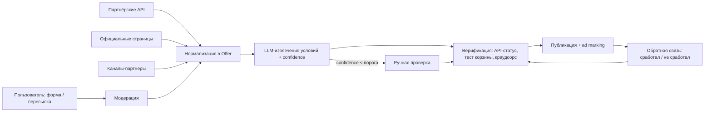
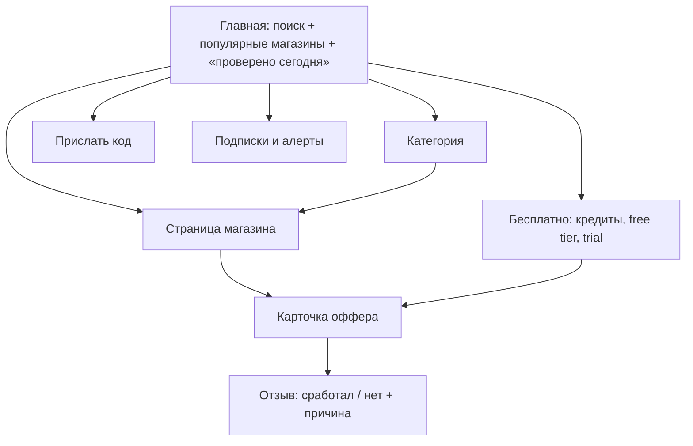
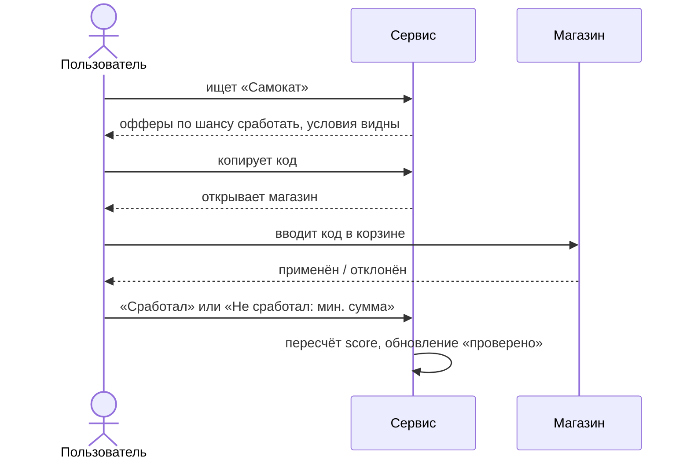
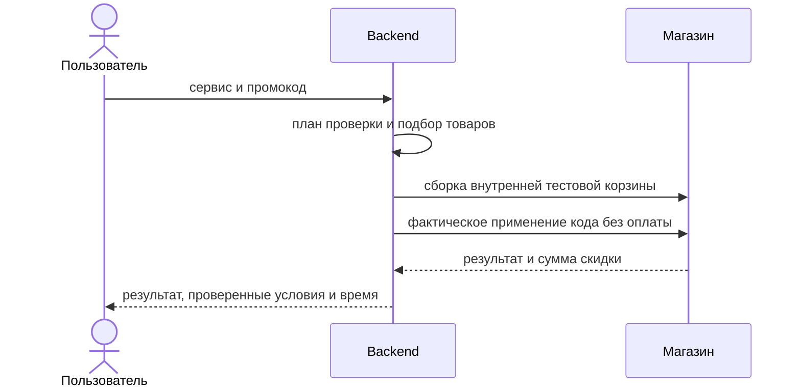

# ARD: сервис поиска промокодов, акций и бесплатных офферов

Analysis & Requirements Document. Версия 0.1, 11.11.2026.
Назначение: зафиксировать выводы ресёрча и требования к фичам и дизайну. Проблемное интервью (гипотеза №1) проверяет раздел 1; остальные разделы после интервью пересматриваются.

Полные отчёты с источниками:
[01 — конкуренты](research/01-competitors.md) · [02 — боли и рынок](research/02-user-pain.md) · [03 — Telegram, право, валидация](research/03-telegram-legal-tech.md) · [04 — free credits / free tier](research/04-free-credits.md).
Ниже ссылки только на ключевые цифры; остальное — в отчётах.

---

## 1. Проблема и гипотеза

### 1.1. Исходная гипотеза
Люди 18–45 лет, покупающие онлайн 2–3+ раза в месяц, тратят время на поиск рабочего промокода и разбор условий; выдача забита SEO-страницами и протухшими кодами; итог — потеря времени, отказ от скидки или переплата.

### 1.2. Что показал ресёрч
Гипотеза подтверждается частично. Кодов хватает: рабочий код есть у 81% магазинов ([Offertium, 27.10.2026](https://offertium.com/guides/promo-code-success-rate)). Боль в другом: **нельзя быстро понять, сработает ли конкретный код в моей корзине**.

| Факт | Значение | Источник |
|---|---|---|
| Публичные коды, работающие «как написано» | 39%; ещё 20% — только при условии (74% из них ограничены товарами, 15% — мин. суммой, 6% — первым заказом) | [Offertium, 10.2026](https://offertium.com/guides/promo-code-success-rate) |
| Сталкивались с невыполненными условиями кода (РФ) | 79%; из них 61% отказались от покупки | [Выберу.ру, 08.2025](https://pr.parnas.info/finansy/polovina-oproshennykh-rossiyan-ekonomit-na-pokupkakh-blagodarya-pro-r2/) |
| Отказывались от покупки из-за долгого поиска выгоды | 88% | [Апельсин, 08.2026](https://www.retail.ru/news/apelsin-88-rossiyan-otkazyvayutsya-ot-pokupki-iz-za-dolgogo-poiska-vygodnoy-stoi-25-avgusta-2026-281355/) |
| Тратили на проверку кодов больше времени, чем составила скидка | 55%; 92% перепроверяют найденное | [Анкетолог, 11.2026](https://iom.anketolog.ru/2026/11/03/skidki-i-promokody-cherez-ii) |
| Ищут скидки через ИИ; главная жалоба | 69%; 34% — «коды не работают / устарели» | там же |
| Где ищут коды (РФ) | 42% агрегаторы, 25% сайт магазина, 17% рассылки, 10% соцсети | [Выберу.ру](https://pr.parnas.info/finansy/polovina-oproshennykh-rossiyan-ekonomit-na-pokupkakh-blagodarya-pro-r2/) |
| Telegram-посты с кодом, где указан срок | 9,8% (код есть в 44,8% постов) | [TGScope, 2026](https://tgscope.io/telegram-deal-channels/coupon-codes) |

### 1.3. Уточнённая гипотеза (рабочая)
> Активные онлайн-покупатели теряют время и деньги не потому, что кодов нет, а потому что не могут **до оплаты** узнать, какой код или оффер применим к их заказу (товары, сумма, первый заказ, регион, суммируемость), и не доверяют источникам, у которых нет даты проверки.

Контр-аргументы, которые интервью должно проверить, а не обойти:
- 49% россиян промокодами не пользуются ([Выберу.ру](https://pr.parnas.info/finansy/polovina-oproshennykh-rossiyan-ekonomit-na-pokupkakh-blagodarya-pro-r2/)); 85% получают кешбэк от банков ([Апельсин/NBJ](https://nbj.ru/news/bolee-poloviny-rossiyan-prosyat-kartu-lo/74480/)).
- Маркетплейсы снимают потребность сами: 61,3% заказов WB в распродажу — акционные товары ([New Retail, 11.11.2026](https://new-retail.ru/novosti/retail/bolee_60_zakazov_na_wildberries_prishlis_na_tovary_so_skidkami/)).
- Доля «секретных» кодов в закрытых Telegram-каналах публично не измерена; утверждение «большинство кодов в закрытых каналах» не подтверждено ([03, §1.5](research/03-telegram-legal-tech.md)).

---

## 2. Аудитория

### 2.1. Сегменты по приоритету
| # | Сегмент | Почему | Данные |
|---|---|---|---|
| 1 | Доставка еды и продуктов | высокая частота, №1 по использованию кодов | 33% используют коды; 19% заказывают несколько раз в неделю |
| 2 | Маркетплейсы, одежда, электроника | большой чек, сложные условия (WB Клуб, купоны продавца, один код на заказ в Ozon) | 61,3% заказов WB — акционные |
| 3 | Подписки и цифровые сервисы | регулярные платежи, trial-ловушки | 20% используют коды |
| 4 | Разработчики и студенты: облака, AI-API, SaaS | новая категория «бесплатные кредиты»; много протухших обзоров | см. [04](research/04-free-credits.md) |
| 5 | Путешествия, такси | высокий чек / частота, но коды используют 8–10% | — |

Источники цифр 1–3, 5 — [02, §3](research/02-user-pain.md).

### 2.2. Персоны
- **Аня, 27, «доставка по будням».** Заказывает еду 3–4 раза в неделю, держит 2–3 приложения. Ищет код за 30 секунд перед оплатой; если не нашла — платит полную цену. Нужно: «что сработает в Самокате прямо сейчас на мой заказ 1 400 ₽».
- **Дима, 34, «крупная покупка».** Раз в месяц берёт технику на маркетплейсе, готов потратить 15 минут ради 10–20%. Нужно: сравнение «код + кешбэк банка + баллы» и честное предупреждение, что код отменит кешбэк.
- **Кирилл, 21, студент-разработчик.** Ищет бесплатный VPS/кредиты на облако и AI-API. Нужно: «что реально доступно мне из РФ, без зарубежной карты, и что будет после окончания триала».

### 2.3. Jobs To Be Done
1. Перед оплатой в магазине X найти код, который точно применится к моему заказу.
2. Понять условия до того, как потрачу время: мин. сумма, категории, первый заказ, суммируемость, срок.
3. Узнать о выгодном оффере заранее (подписка на бренд/категорию), а не в момент оплаты.
4. Найти бесплатный ресурс (кредиты, free tier, trial), который доступен именно мне.
5. Поделиться найденным кодом и увидеть, что он помог другим (социальная валидация).

---

## 3. Конкуренты и незанятые ниши

| Игрок | Вход | Сильное | Слабое |
|---|---|---|---|
| promokodi.ru/.net, promokod.com | сайт, SEO | широкий каталог | бейджи «100%» без даты проверки, SEO-мусор |
| Pepper.ru | сайт, приложение, TG | голосование «температурой», комментарии правят условия | условия зависят от аккаунта/региона, нет статистики успешности |
| Т-Промокоды, Яндекс Выгода | расширение / браузер | автоподстановка, бренд | нет гарантии по магазину, конфликт интересов |
| Backit, Megabonus, Picodi | сайт, расширение | кешбэк | код может обнулить кешбэк, сбои начислений |
| Маркетплейсы, банки | приложение | встроенные скидки | персональность, разрозненность, лимиты |
| Telegram-каналы и боты | Telegram | эксклюзивные коды под канал | нет срока (9,8%), реклама, Telegram в РФ деградирует |
| Global: RetailMeNot, SimplyCodes, Offertium, Karma | приложение, расширение, AI-агент | проверка в корзине, Health Score, Working Code Promise | в РФ не работают |
| free-for.dev, awesome-списки | GitHub | огромные списки | нет региона/eligibility, нет статуса «оффер завершён» |
| [vldtech.si/offers](https://vldtech.si/offers/) | сайт (Astro, статика) + TG-канал автора [@neurovestnik](https://t.me/neurovestnik) | ближайший аналог раздела «Бесплатно»: 53 оффера в 7 категориях (ИИ-модели 29, VPS 7, Cloud VM 5, поиск для агентов 5, прокси 3, SMS 3, карты 1); статус «Активно / Частично / Истекло», дата проверки на каждой карточке, чипы «Нужно: карта, номер, задания, VPN», флаг «Есть момент», сортировка по ценности или дате проверки, бонус по промокоду поверх оффера | один куратор; нет доступности из РФ (AWS, Oracle, GCP, Azure показаны «Активно» без пометки, что регистрация из РФ закрыта); нет «что будет после окончания», истории изменений, обратной связи пользователей; монетизация — донаты; категории «виртуальные карты» и «SMS-номера» — инструменты обхода KYC/гео (см. ADR-06) |

Подробно — [01](research/01-competitors.md), [04](research/04-free-credits.md).

**Ниши, которые никто в РФ не закрывает:**
1. Проверяемый процент успешности кода и дата последней проверки.
2. Условия оффера в структурированном виде до клика.
3. Сводная выгода: код + кешбэк + баллы + банк, с конфликтами («код отменит кешбэк 5%»).
4. Eligibility для free-офферов: страна, карта, новый аккаунт, студент — и статус «оффер завершён».
5. «Не воруем affiliate» как явное обещание: после скандала Honey ([The Verge, 12.2024](https://www.theverge.com/2024/12/23/24328268/honey-coupon-code-browser-extension-scam-influencers-affiliate-marketing)) и политики Chrome Web Store от 10.06.2025 ([Google](https://developer.chrome.com/blog/cws-policy-update-affiliate-ads-2025)).

---

## 4. Позиционирование и границы продукта

**Позиционирование:** «Проверенные скидки с понятными условиями: видно, что сработает именно у вас и когда это проверяли».

**Типы контента (одна сущность «Оффер», разные типы):**
| Тип | Пример | Ключевое отличие |
|---|---|---|
| `promo_code` | `SAMOKAT300` −300 ₽ от 1 500 ₽ | строка кода, корзинные условия |
| `sale` | «−50% на вторую пиццу по вторникам» | без кода, срок и механика |
| `cashback` | банк/сервис возвращает 10% | конфликтует с кодами |
| `free_credit` | Yandex Cloud грант ≥4 000 ₽ на 60 дней | сумма, длительность, требования к аккаунту |
| `free_tier` | Cloudflare Free, Netlify Free | постоянные лимиты, без срока |
| `trial` | 30 дней подписки бесплатно | авто-списание после окончания |
| `student` / `startup` | GitHub Student Pack | верификация статуса |

**Вне рамок MVP:** собственный кешбэк с выплатами, мобильное нативное приложение, автоприменение кодов в чужом чекауте, скрейпинг закрытых Telegram-каналов (см. ADR-02).

---

## 5. Фичи и требования

Приоритет: **P0** — MVP, без них нет продукта; **P1** — следующий релиз; **P2** — после подтверждения спроса; **Отложено** — снято с первой версии (ADR-08), макеты лежат отдельно.

### 5.1. Поиск и каталог
| ID | Требование | P |
|---|---|---|
| F-01 | Единый поиск по магазинам и сервисам с автодополнением: промокоды, акции и бесплатные офферы ищутся вместе; результат — страница магазина или сервиса | P0 |
| F-02 | Страница магазина: офферы отсортированы по «шансу сработать», затем по выгоде | P0 |
| F-03 | Фильтры: тип оффера, категория, «новым клиентам / всем», мин. сумма ≤ X, «доступно из РФ» | P0 |
| F-04 | Каталог: все магазины и сервисы с рубрикатором (еда, маркетплейсы, одежда, подписки, путешествия, бесплатно › облака/ИИ/хостинг/инструменты/студентам); на главной магазины и сервисы — одной группой | P0 |
| F-05 | Ветка каталога «Бесплатно»: free_credit, free_tier, trial, student; фильтры по требованиям (без карты, без зарубежной карты, физлицо) | P1 |
| F-06 | Режим «у меня корзина»: пользователь вводит сумму, категорию, новый/старый клиент → список отфильтрован по применимости | Отложено |
| F-07 | Сравнение выгоды: код vs кешбэк vs баллы с предупреждением о конфликтах | P2 |

### 5.2. Карточка оффера
| ID | Требование | P |
|---|---|---|
| C-01 | Код копируется одним тапом; после копирования — переход в магазин | P0 |
| C-02 | Условия структурированно: выгода, мин. сумма, категории, первый заказ, суммируемость, регион, срок | P0 |
| C-03 | Статус проверки: «Проверено N мин/ч назад», источник проверки (партнёрский API / тест / пользователи) | P0 |
| C-04 | Шанс сработать: 0–100 и «сработал у N из M за 7 дней» | P0 |
| C-05 | Кнопки «Сработал» / «Не сработал» + причина (истёк, не та категория, мин. сумма, только новым, другое) | P0 |
| C-06 | Источник оффера: магазин / партнёрская сеть / канал-партнёр / пользователь; ссылка на первоисточник | P0 |
| C-07 | Пометка «Реклама», рекламодатель, erid — на каждой карточке с партнёрской ссылкой | P0 |
| C-08 | Для free-офферов: требования (карта, телефон, KYC, домен), «доступно из РФ: да/нет + причина», «что будет после окончания» — в той же карточке, что у промокодов (ADR-07) | P1 |
| C-09 | История: когда появился, когда менялись условия, «оффер завершён» вместо удаления | P1 |
| C-10 | Запрещены формулировки «100% рабочий», «до 90%» без указания товаров | P0 |

### 5.3. Подписки и уведомления
| ID | Требование | P |
|---|---|---|
| N-01 | Подписка на магазин или категорию; уведомление о новом проверенном оффере | Отложено |
| N-02 | Алерты по ключевым словам («Xiaomi», «VPS бесплатно») | Отложено |
| N-03 | Напоминание об окончании trial / кредита, который пользователь отметил как активированный | P2 |
| N-04 | Каналы доставки: веб-push, бот в MAX, бот в Telegram (последний — с учётом ADR-03) | Отложено |

### 5.4. Сбор данных (подробно — раздел 7)
| ID | Требование | P |
|---|---|---|
| D-01 | Импорт из партнёрских API (Admitad Coupons, Adv.Cake) с полями срока, статуса, персональности | P0 |
| D-02 | Парсинг официальных страниц акций и free tier (магазины, облака) с отслеживанием изменений по хешу | P0 |
| D-03 | Форма «Прислать код»; модерация перед публикацией. Пересылка поста боту — отложено (ADR-08) | P0 |
| D-04 | Подключение Telegram/MAX-каналов-партнёров: владелец добавляет бота админом, бот читает новые посты | Отложено |
| D-05 | LLM-извлечение условий из текста в структуру + confidence; ниже порога — ручная проверка | P1 |
| D-06 | Фактическая проверка кода: backend сам подбирает товары и собирает внутреннюю тестовую корзину, применяет код через разрешённый API или контролируемый тестовый аккаунт, сохраняет скидку, условия и время; пользователь корзину не собирает, оплаты нет | P0 |
| D-07 | Личный радар: пользователь подключает свой Telegram и видит коды из своих подписок только для себя (см. ADR-02) | P2 |

### 5.5. Сообщество
| ID | Требование | P |
|---|---|---|
| S-01 | Голосование «горячо/холодно» по офферу, влияет на сортировку | P1 |
| S-02 | Комментарии к офферу с уточнением условий | P2 |
| S-03 | Репутация автора: доля присланных кодов, которые сработали | P2 |

---

## 6. Модель данных

Одна сущность `Offer`; тип определяет обязательные поля.

```text
Offer
  id, type                      promo_code | sale | cashback | free_credit | free_tier | trial | student | startup
  merchant_id                   магазин / провайдер
  title, description_short      без маркетинговых превосходных степеней
  code?                         строка, если type = promo_code
  value                         amount + currency + kind (fixed | percent | credit | quota)
  conditions
    min_order?                  сумма
    categories_include[]/exclude[]
    customer_type               all | new | existing
    stackable_with[]            кешбэк, баллы, другие коды
    platform                    web | app | both
    region_allow[]/deny[]       включая «доступно из РФ»
    requirements[]              card | foreign_card | phone | kyc | corporate_domain | student_status
    personal / one_time         такие коды НЕ публикуются (ADR-02)
  starts_at, expires_at?
  clock_start?                  registration | activation (для кредитов/trial)
  after_end                     что происходит после окончания (авто-списание, закрытие аккаунта, удаление ресурсов)
  gotchas[]                     idle-reclaim, non-commercial only, обучение на данных и т.п.
  source                        partner_api | official_page | partner_channel | user_submission | user_forward
  source_url, source_seen_at
  ad_marking                    advertiser, inn, erid (если есть партнёрская ссылка)
  verification
    last_checked_at, method     api | cart_test | crowd | manual
    score 0–100
    success_7d, fail_7d, fail_reasons{}
  lifecycle                     draft | active | changed | expired | ended | rejected
  change_hash, history[]
```

---

## 7. Источники данных и позиция по каждому

| Источник | Что даёт | Риск | Решение для MVP |
|---|---|---|---|
| Партнёрские API (Admitad, Adv.Cake) | легальные коды с атрибуцией, сроком, `is_personal`, `used_24h` | средний: неполное покрытие | **P0, основа** |
| Официальные страницы акций и free tier | первичные условия | низкий | **P0**, отслеживание изменений |
| Присланное пользователями (форма, пересылка боту) | Telegram-эксклюзивы с согласия пользователя | средний: фейки, спам | **P0**, модерация + проверка; публикуем факты, не текст поста |
| Telegram/MAX-каналы-партнёры | эксклюзивы с согласием владельца, rev-share | средний: стоимость договорённостей | **P1** |
| Публичные Telegram-каналы через `t.me/s` / userbot | объём | высокий: ToS Telegram §4.3 Bot Developer ToS запрещает скрейпинг каналов; бан аккаунта | **Нет** в проде; только ручной мониторинг редакцией для поиска партнёров |
| Закрытые/платные каналы без договора | эксклюзивы | высокий: ToS, ст. 1270/1334 ГК, сгорание кодов, отзыв кода брендом, нарушение правил Admitad | **Нет**, см. ADR-02 |
| GitHub-списки (free-for.dev) | кандидаты в free-офферы | низкий | P1, как сигнал; истина — официальная страница |

Детали и ссылки — [03](research/03-telegram-legal-tech.md), [04](research/04-free-credits.md).

### 7.1. Конвейер


### 7.2. Оценка «шанса сработать»
Score 0–100 пересчитывается при каждом событии:
- база по методу проверки: API `active` или успешный тест корзины за 24 ч — высокий; только присланный пользователем — низкий;
- краудсорс за 7 дней: успехи/неудачи с весом по репутации автора отзыва;
- свежесть: экспоненциальное затухание от `last_checked_at`;
- понижение до «под вопросом» при 3+ неудачах за 7 дней и доле неудач ≥ 60% (порог из методики [Offertium](https://offertium.com/how-we-verify-codes));
- `expires_at` в прошлом → `expired`, карточка остаётся в истории.

---

## 8. Дизайн и UX

### 8.1. Принципы
1. **Честность важнее объёма.** Лучше 5 проверенных офферов, чем 40 сомнительных. Показываем дату проверки и причины неудач.
2. **Условия видны до клика.** Любое ограничение — на карточке, а не в «Подробнее». Это же требование ФАС: условия и срок в рекламе промокода ([Московское УФАС, 2024](https://base.garant.ru/76098027/)).
3. **10 секунд до кода.** Поиск → магазин → копировать. Без регистрации.
4. **Без тёмных паттернов.** Никаких заблюренных кодов «нажми, чтобы открыть», принудительных переходов, фейковых таймеров. Именно они используются мошенниками ([Pikabu, 06.2026](https://pikabu.ru/story/ocherednoe_moshennichestvo_pod_vidom_ozona_14041784)).
5. **Прозрачная монетизация.** Видно, где партнёрская ссылка; пометка «Реклама» не прячется.

### 8.2. Информационная архитектура


### 8.3. Анатомия карточки промокода
```text
┌──────────────────────────────────────────────────────────┐
│ Самокат                                     Реклама · erid │
│ −300 ₽ на заказ от 1 500 ₽                                │
│ ┌────────────────────┐                                    │
│ │  SAMOKAT300   [⧉]  │   Шанс сработать: 86              │
│ └────────────────────┘   ✓ 41 из 47 за 7 дней             │
│ Проверено 2 ч назад · партнёрский API                     │
│ ── Условия ───────────────────────────────────────────── │
│ • Только первый заказ            • До 30.11.2026          │
│ • Не суммируется с баллами       • Только в приложении    │
│ ──────────────────────────────────────────────────────── │
│ [ Сработал ]  [ Не сработал ▾ ]          Источник ↗       │
└──────────────────────────────────────────────────────────┘
```
Правила: выгода — самый крупный текст; код — моноширинный, копируется по тапу на всю плашку; условия-ограничения выделены цветом предупреждения, нейтральные — обычным; шанс < 40 показывается серым бейджем «под вопросом», а не прячется.

### 8.4. Анатомия карточки free-оффера
```text
┌──────────────────────────────────────────────────────────┐
│ Yandex Cloud · стартовый грант                            │
│ ≥ 4 000 ₽ на 60 дней                                      │
│ Доступно из РФ: да                                        │
│ Нужно: карта РФ при создании платёжного аккаунта          │
│ После окончания: потребление становится платным           │
│ Подвох: грант не тратится на GPU и Marketplace            │
│ Проверено 11.11.2026 · официальная документация ↗         │
└──────────────────────────────────────────────────────────┘
```
Офферы, недоступные из РФ (AWS, Oracle Cloud, GCP, Azure — [04](research/04-free-credits.md)), показываются с бейджем «Недоступно из РФ: регистрация закрыта» и скрыты фильтром по умолчанию. Пример с AWS $100 и Oracle Always Free остаётся валидным контентом для пользователей с зарубежным резидентством, но не ядром для РФ.

Паттерны, взятые у [vldtech.si/offers](https://vldtech.si/offers/) (проверено 11.11.2026): дата проверки и статус на карточке, чипы требований, флаг «есть подвох», сортировка «по ценности / по дате проверки», промокод-бонус поверх базового оффера. Отличаемся моделью eligibility (доступно ли мне) и обратной связью пользователей.

### 8.5. Поиск и применение найденного кода


Проверка своего кода — отдельный основной сценарий. Пользователь не вводит параметры корзины:



### 8.6. Состояния, которые надо отрисовать
- Магазин без офферов: «Проверенных кодов сейчас нет», последняя дата, кнопка «Прислать код».
- Все коды «под вопросом»: показываем, но с объяснением.
- Оффер завершён: карточка в истории, серая, с датой завершения.
- Код персональный/одноразовый: не публикуется, вместо него — «как получить свой код».
- Нет сети: веб показывает сохранённые данные.

### 8.7. Платформы
| Платформа | Роль | P |
|---|---|---|
| Адаптивный веб (mobile-first) | основной продукт, SEO по магазинам | P0 |
| Бот в MAX | алерты, пересылка постов, быстрый поиск | Отложено |
| Бот в Telegram | то же, вторично (ADR-03) | Отложено |
| Расширение браузера | подсказка на странице чекаута по действию пользователя; affiliate только при реальной выгоде (политика CWS) | P2 |

---

## 9. Нефункциональные и правовые требования
| ID | Требование |
|---|---|
| L-01 | ИП/юрлицо и договор с ОРД до запуска; каждая карточка с партнёрской ссылкой — «Реклама», рекламодатель, ИНН, erid (38-ФЗ, ст. 18.1). Штраф за отсутствие — 200–500 тыс. ₽ для юрлица ([03, §2.1](research/03-telegram-legal-tech.md)) |
| L-02 | Не публиковать коды, не предназначенные нашей площадке, в партнёрских ссылках (правила Admitad #80) |
| L-03 | Нужна ли регистрация — открытый продуктовый вопрос. Не делаем аккаунт обязательным условием архитектуры проверки; состав сохраняемых данных и требования к их обработке определяем до реализации выбранного варианта |
| L-04 | Не копировать посты целиком: извлекаем факты (код, магазин, условия, срок), ссылка на источник (ст. 1274 ГК) |
| L-05 | Не передавать данные из Telegram в LLM без юридической оценки (API ToS §1.5 запрещает использовать данные платформы для развёртывания ИИ); LLM в MVP — на партнёрских фидах и официальных страницах |
| N-01 | Время от открытия до скопированного кода ≤ 10 с на мобильном |
| N-02 | Свежесть: офферы топ-100 магазинов проверяются не реже 1 раза в 24 ч |
| N-03 | Боты автотестов представляются в User-Agent и не совершают оплату |

---

## 10. Метрики
| Метрика | Что показывает | Цель MVP |
|---|---|---|
| Доля «Сработал» среди отзывов | качество данных | ≥ 70% (рынок: 39% у публичных кодов) |
| Время до копирования кода (медиана) | скорость | ≤ 10 с |
| Доля офферов с `last_checked_at` < 24 ч | свежесть | ≥ 80% топ-100 магазинов |
| Возвраты за 7 дней | ценность | ≥ 25% |
| Доля сессий с отзывом | вовлечённость в верификацию | ≥ 10% |
| Присланные коды, прошедшие модерацию | качество краудсорса | наблюдаем |

Целевые значения — стартовые предположения, пересматриваются после первых 2 недель.

---

## 11. Риски
| Риск | Уровень | Митигация |
|---|---|---|
| Проблема не подтвердится в интервью (кешбэк и скидки маркетплейсов закрывают потребность) | высокий | фокус на сегментах 1–2; проверить вопросами о последнем провале кода |
| Telegram в РФ деградирует: DAU 33,8 млн в 08.2026 против ~72 млн в 03.2026 ([Эксперт/Mediascope](https://expert.ru/tekhnologii/kak-max-obognal-telegram), [РБК/Mediascope](https://amp.rbc.ru/rbcnews/technology_and_media/09/04/2026/69d77f029a7947f9e3725a9d)) | высокий | веб и MAX как основные каналы; Telegram — источник, не платформа |
| Скрейпинг Telegram / закрытых каналов | высокий | не делаем; партнёрства и пересылки (ADR-02) |
| Немаркированная реклама | высокий | L-01 до запуска |
| Нарушение правил партнёрских сетей | высокий | L-02 |
| Бот-защита магазинов ломает автотесты (33% пар заблокированы в исследовании OpenShopGraph) | высокий | проверяем осуществимость для первого сервиса; используем разрешённый API или тестовую корзину, при блокировке не выдаём неподтверждённый вердикт |
| Накрутка отзывов «сработал/нет» | средний | вес по репутации, rate-limit по device-token |
| Ошибки LLM в условиях | средний | confidence + ручная проверка |
| Free-офферы тихо меняются (Hetzner, VK Cloud) | средний | хеш страницы, статус `changed`/`ended` |

---

## 12. Решения (ADR-lite)

**ADR-01. Ядро продукта — верификация и условия, а не объём каталога.**
Причина: коды есть у 81% магазинов, проблема в применимости. Альтернатива «больше кодов, чем у promokodi» отвергнута: повторяет модель конкурентов с низким доверием.

**ADR-02. Закрытые Telegram-каналы: не скрейпим, получаем коды по согласию.**
Контекст: гипотеза команды — значительная часть «секретных» кодов публикуется в закрытых каналах. Ресёрч: долю не измерял никто; техническое чтение требует userbot-аккаунтов (бан, `FloodWait`, ручная модерация join-request), нарушает Telegram ToS (Content Licensing, Bot Developer ToS §4.3, API ToS §1.4–1.5), создаёт риски по ст. 1270/1334 ГК; после публикации лимитированные коды сгорают или отзываются брендом, а партнёрские сети отклоняют конверсии по чужим кодам.
Решение — три законных пути:
1. **Канал-партнёр** (P1): владелец добавляет нашего бота админом, получает rev-share или выделенный код для нашей аудитории.
2. **Пересылка пользователем** (P0): пользователь сам пересылает пост боту с согласием; публикуем факты, не текст; персональные коды не публикуем.
3. **Личный радар** (P2, требует юриста): пользователь подключает собственный Telegram-аккаунт, сервис показывает коды из его подписок **только ему**, без перепубликации. Ценность закрытых каналов сохраняется, коды не утекают. `[INFERENCE]` Соответствие API ToS §1.4 (действия от имени пользователя с его ведома) не проверено юристом.
Отвергнуто: userbot-сеть, покупка доступа к платным каналам и перепубликация.

**ADR-03. Каналы доставки: веб первым, MAX наравне с Telegram.**
Причина: замедление Telegram с 02.2026 и рост MAX (DAU 69,9 млн в 08.2026 по Mediascope). Telegram-бот остаётся, но не единственный.

**ADR-04. Free-офферы — отдельный раздел с моделью eligibility.**
Причина: у них нет кода, ключевое — кто может получить (регион, карта, новый аккаунт). Большинство западных офферов закрыты для РФ (AWS, Oracle, GCP, Azure, OpenAI, Gemini API); без бейджа доступности раздел будет вводить в заблуждение.
Уточнено ADR-07: отдельного раздела нет — «Бесплатно» стал веткой общего каталога, карточка и поиск общие с промокодами.

**ADR-05. Решение о регистрации открыто (уточнено 16.11.2026).**
Наличие регистрации, её назначение и способы входа ещё определяет продуктовая команда. Не считаем ни обязательный вход, ни окончательный отказ от аккаунтов согласованным решением. Внутренняя проверка промокода не должна зависеть от реализации регистрации.

**ADR-06. Не публикуем инструменты обхода KYC и гео-ограничений.**
Контекст: агрегаторы free-офферов (например, vldtech) рядом с кредитами AWS/Oracle публикуют виртуальные карты и SMS-номера, чтобы пройти регистрацию из закрытых регионов. Провайдеры запрещают мульти-аккаунты и обход проверок (Oracle — один аккаунт на человека, Anthropic банит за мульти-аккаунты — [04](research/04-free-credits.md)); аккаунт и ресурсы могут быть удалены.
Решение: показываем честный статус «Недоступно из РФ» и причину; категории «карты» и «номера для верификации» не ведём. Альтернатива «вести как у конкурента» отвергнута: риск бана пользователя ложится на наш совет, а для студенческого проекта это репутационный и, при партнёрских ссылках, договорный риск.

**ADR-07. Одна карточка и один поиск для всех офферов (16.11.2026).**
Контекст: в макетах промокоды и бесплатные офферы рисовались разными карточками (`OfferCard` и `FreeOfferCard`) с разным порядком блоков и разными кнопками; на главной они стояли рядом и выглядели как два продукта.
Решение: один компонент `OfferCard`. Отличаются только слоты: код или кнопка перехода, шанс сработать или доступность из РФ, условия списком. Провайдеры бесплатных офферов (Yandex Cloud, GitHub) — такие же «магазины и сервисы»: попадают в общий поиск, плитки и ленты. На главной магазины и сервисы показываются одной группой, деление по темам — в каталоге (P-06), где «Бесплатно» — ветка рубрикатора; пункты меню «Категории» и «Бесплатно» заменены одним «Каталог».

**ADR-08. Первая версия без подписок, подбора под корзину и бота (16.11.2026).**
Решение команды: сузить первую версию до веба. Сняты N-01, N-02, N-04, F-06, D-04, пересылка поста боту из D-03 и боты из 8.7. Макеты перенесены на страницу Figma `99 Отложено: подписки, корзина, бот`; пути ADR-02 через бота (канал-партнёр, пересылка) вернутся вместе с ботом.
Уточнение: F-06 — пользовательский подбор под личную корзину, а не наша внутренняя проверка. Пользователь не собирает корзину и не вводит её параметры. Backend сам набирает тестовую корзину для реального применения кода; эта механика входит в D-06 и не отложена вместе с экраном корзины.

---

## 13. Открытые вопросы
1. Насколько часто в интервью всплывают закрытые Telegram-каналы как источник кодов? Добавить в интервью вопрос: «Откуда был код, который в последний раз сработал? Платили ли вы за доступ к каналу?»
2. Готовы ли владельцы каналов-промокодников к rev-share? Нужны 5–10 разговоров с админами.
3. Модель дохода: CPA-комиссия (требует ОРД) vs B2B-данные для AI-ассистентов vs подписка. 3%-сбор с рекламного дохода к CPA — позиция юриста.
4. Какой из сегментов 1–2 взять первым для MVP-каталога (30–50 магазинов)?
5. Нужен ли раздел «Бесплатно» в MVP или сначала проверить спрос отдельным лендингом?

## 14. Связь с проблемным интервью
Вопросы, которые стоит добавить к гипотезе №1 (без подсказки решения):
- «Где вы нашли код, который в последний раз сработал? Как туда попали?» — проверяет роль Telegram и закрытых каналов.
- «Что было написано рядом с кодом? Чего не хватило, чтобы понять, подойдёт ли он?» — проверяет C-02.
- «Бывало, что код сработал, но отменил кешбэк или баллы?» — проверяет F-07.
- Для сегмента 4: «Когда вы в последний раз искали бесплатный сервер/кредиты? Что помешало получить?» — проверяет ADR-04.
