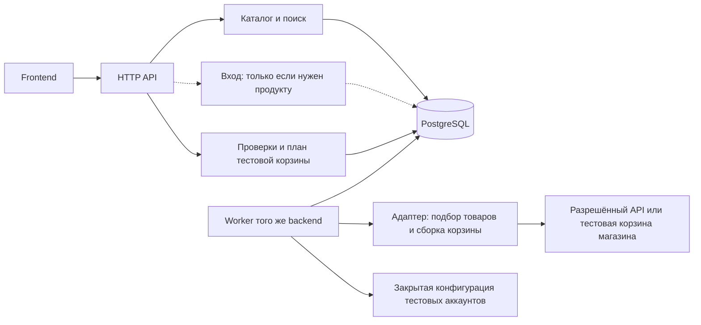
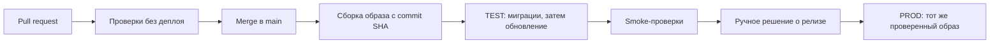

# Backend: архитектурный проект

Статус: проект архитектуры, не описание уже реализованной системы. В этот PR входят только PostgreSQL и локальный запуск. Основные функции продукта — поиск и фактическая проверка промокода; язык backend и конкретный способ интеграции ещё согласуем. Нужна ли регистрация — отдельный продуктовый вопрос.

## Границы

- В актуальном `main` ADR-07 задаёт общий каталог офферов: промокоды, акции и бесплатные предложения.
- ADR-08 откладывает пользовательский подбор под личную корзину, подписки и ботов. Пользователь не собирает корзину в нашем интерфейсе и не задаёт её параметры.
- Для проверки backend сам подбирает товары и собирает внутреннюю тестовую корзину. Фактическая проверка входит в основной сценарий, а не откладывается вместе с экраном корзины.
- Регистрация может понадобиться или не понадобиться; пока не считаем её ни обязательной, ни окончательно исключённой. Реализация проверки не блокируется выбором способа входа.
- Не выбираем первый магазин автоматически. Архитектура поддерживает адаптеры разных сервисов; первый адаптер выбираем по доступности разрешённого способа проверки.

## Схема сервиса

Сплошные линии — основной целевой сценарий поиска и проверки; пунктир — возможная авторизация. Схема не означает, что эти компоненты уже реализованы в инфраструктурном PR.

Предлагаем модульный монолит: один проект, одна БД, позднее API и worker запускаются разными процессами из одного приложения.

| Модуль | Ответственность |
|---|---|
| HTTP API | Разбор запроса, проверка входных данных и прав, вызов сценария, ответ |
| Каталог | Магазины/сервисы, предложения, источники и условия |
| Проверки | Контекст, жизненный цикл задания, классификация результата и свежесть |
| Адаптер сервиса | Перевод нашего контракта в API или тестовую корзину конкретного магазина |
| Identity | Возможные аккаунты и сессии, только если продуктовая команда решит их добавить |
| PostgreSQL | Данные каталога; позднее задания и история попыток |

HTTP-обработчики и адаптеры не решают самостоятельно, когда показывать «проверен»: этим владеет модуль проверок. Бизнес-сценарии не зависят от конкретного магазина; подключения собираем в точке запуска приложения. Не создаём отдельные сервисы и интерфейсы для каждого простого CRUD.

Язык пока не выбран. Go — кандидат; сначала согласуем с командой. REST/JSON подходит для текущего frontend; контракт фиксируем до реализации.

## Нужны ли Kafka и Redis

Нет для первого этапа. Каталогу брокер не нужен, а небольшую очередь проверок можно хранить в PostgreSQL. После создания worker используем короткий захват задания с `FOR UPDATE SKIP LOCKED`, срок владения и ограниченные повторы.

- Не держим SQL-транзакцию во время внешнего HTTP-запроса.
- После падения worker задание не теряется; устаревший worker не может перезаписать новый результат.
- Kafka обсуждаем при независимых потребителях, необходимости проигрывать журнал событий или измеренных ограничениях очереди.
- Redis добавляем только при измеренной необходимости общего кеша или распределённых ограничений нагрузки.

Это предложение для нашего небольшого учебного проекта, а не утверждение, что Kafka или Redis бесполезны вообще.

## Основной сценарий проверки

1. Пользователь выбирает сервис и вводит код. API сохраняет запрос и задание в одной транзакции, возвращает `202` и идентификатор. Товаров и суммы корзины во входной форме нет.
2. Backend определяет доступные условия кода и сам формирует план проверки: подходящие товары, сумму, регион/канал и тестовый профиль.
3. Worker через адаптер набирает реальные доступные товары, изолированно собирает корзину и фактически применяет код — без оформления заказа и оплаты.
4. Сохраняем фактическую корзину, сумму до/после применения, полученную скидку, условия, метод и время. Frontend получает состояние через опрос API.
5. Если условия неизвестны, товары недоступны или ответ неоднозначен, фиксируем неполную проверку, а не выдумываем подтверждение. Число вариантов и повторов ограничено.
6. Повторяем только подходящие технические ошибки с задержкой и пределом попыток.

`applied` означает фактически полученную скидку в проверенном контексте. `not_applicable` означает определённый отказ именно для этого контекста. Неоднозначность — `inconclusive`; таймаут, CAPTCHA или недоступность магазина — техническая ошибка, а не «промокод не работает».

Цель — доказанный факт применения кода, а не догадка или процент доверия. Но успешная проверка подтверждает применение при реально проверенных условиях, а не гарантирует скидку на любом личном аккаунте. План тестовой корзины формирует backend; фактический контекст храним отдельно. Статус «код активен» в партнёрском фиде не равен фактическому применению в корзине.

Пользовательский код не публикуется автоматически. Не принимаем пароли/cookies магазинов от пользователей, не оформляем и не оплачиваем заказ. Неизвестный исход запроса, который мог расходовать одноразовый код, не повторяем вслепую.

Для первого адаптера выполняем проверки последовательно на одном тестовом профиле. Lease задания защищает запись результата, но сам по себе не останавливает старый запрос магазина; параллелизм и восстановление корзины должны учитывать это отдельно.

## Регистрация и доступ

Нужна ли регистрация вообще — продуктовый вопрос для менеджеров. Каталог и проверку проектируем без обязательной зависимости от аккаунтов. Если решим добавить личные функции, отдельно выберем способы входа; email+пароль, Google или Telegram сейчас не утверждены.

Пользователь продукта и наш тестовый аккаунт магазина — разные сущности. Приватный результат не должен быть доступен просто по UUID: для варианта без регистрации предусматриваем непрозрачный токен доступа или серверную сессию. Конкретную защиту и лимиты согласуем перед реализацией; это не требует обязательного создания аккаунта.

## Test и prod: только план

Это предлагаемый процесс; workflows, серверы и GitHub Environments сейчас не настроены.

- Только две общие среды: `test` и `prod`. Локальный Docker Compose — рабочее место разработчика, не третья серверная среда.
- В PR выполняем проверки. В `test` выкатываем после merge в `main`, не при каждом открытии PR.
- Продвигаем в `prod` тот же артефакт по SHA/digest, не пересобираем его.
- Среды имеют отдельные БД, тома, пользователей БД, домены и секреты. Продовые данные не копируем на тест автоматически.
- Миграции запускаются один раз перед обновлением приложения; изменения схемы должны быть совместимы с предыдущей версией.
- Откат приложения — на предыдущий образ; откат схемы не считаем автоматическим. Перед изменениями данных предусматриваем резервную копию и проверяем восстановление.
- До настройки выберем хостинг, HTTPS, место секретов и порядок ручного релиза. Сейчас не создаём серверы, платные ресурсы и production credentials.

## Следующие решения

- Каким разрешённым способом первый сервис позволяет backend собирать корзину и применять код?
- Нужна ли регистрация вообще и, только если нужна, для каких действий и какими способами?
- Язык backend, первый сервис и доступный способ проверки.
- Вместо неподтверждённого score показываем наблюдаемые факты; изменение требования о score согласуем отдельно.

## Источники

- [PostgreSQL: SKIP LOCKED для таблиц очередей](https://www.postgresql.org/docs/current/sql-select.html)
- [GitHub: среды и ручные проверки перед деплоем](https://docs.github.com/en/actions/how-tos/deploy/configure-and-manage-deployments/manage-environments)

Это самостоятельный проект: внутренние решения и материалы других проектов не используются.
