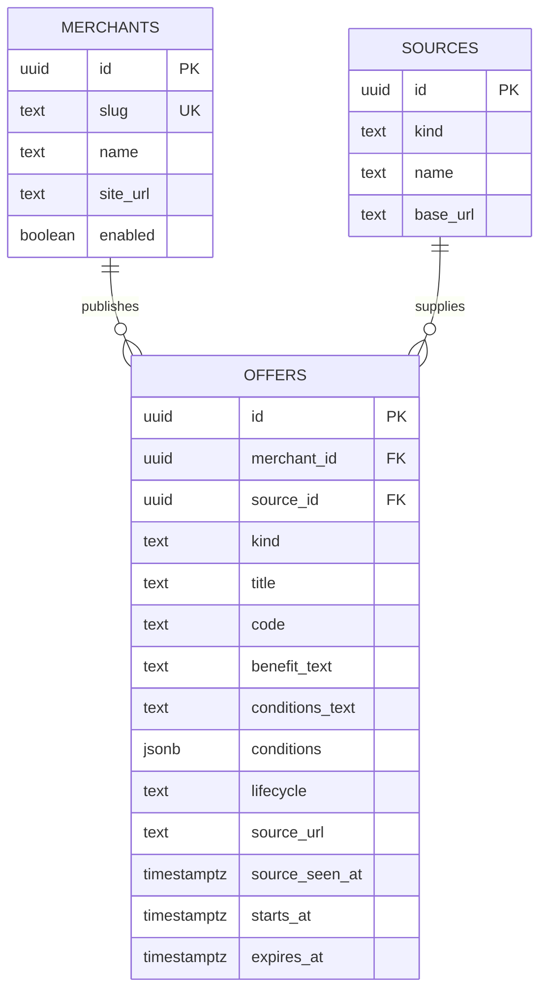
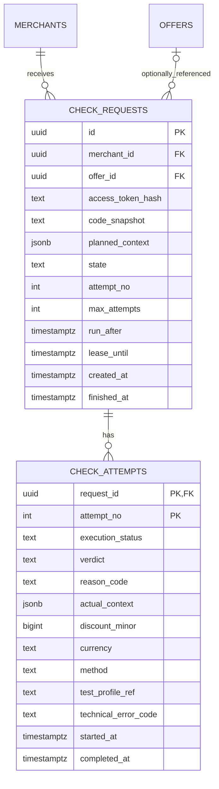

# PostgreSQL: проект модели данных

Статус: ER-предложение, не применённая миграция. Первый инфраструктурный PR поднимает пустой PostgreSQL; таблицы появятся отдельной задачей после согласования.

## Первый этап: каталог

`merchants` — магазины и сервисы. `sources` — источники, например официальная страница или партнёрский фид. `offers` — единая сущность для промокода, акции и бесплатного оффера по ADR-07; отдельная таблица для каждого типа не нужна.

Первоначально у оффера один основной источник. История изменений и несколько подтверждающих источников добавляются при реальной необходимости.

## Ограничения и индексы

- UUID для идентификаторов, `timestamptz` для времени. Денежные суммы, когда появятся, — в минимальных единицах и с валютой.
- У `promo_code` есть непустой код; у предложения без кода он отсутствует. Виды и форма условий должны быть перечислены в API-контракте.
- Срок окончания, если известен, не раньше начала. Неизвестный срок не означает бессрочность.
- `lifecycle` описывает публикацию/завершение предложения, не гарантированную работу кода.
- `conditions_text` — понятный текст; `conditions` — небольшой валидируемый объект условий. Часто используемые фильтры выносим в колонки по реальным запросам.
- Неизвестное условие не превращаем в «ограничения нет». Персональные/одноразовые коды не публикуем.
- `source_seen_at` — время наблюдения источника, не время проверки корзины.
- Не делаем код уникальным на весь каталог: он повторяется у разных магазинов и в разные периоды.
- Начальные индексы: уникальный `merchants.slug`, выдача `offers(merchant_id, lifecycle, kind)` и индексы внешних ключей. Полнотекстовый поиск добавляем по согласованным запросам, без Elasticsearch на старте.

## Запросы и история внутренней проверки

Это часть основного сценария проверки, но не доменная миграция текущего инфраструктурного PR. Пользователь передаёт только сервис и код: план корзины формирует backend. Порядок отдельных миграций согласуем технически; наличие регистрации не является предварительным условием.

`check_requests` — одновременно снимок запроса и строка долговечной очереди. `check_attempts` — история запусков. Отдельные таблицы jobs, results и outbox для этого сценария пока не нужны.

`offer_id` необязателен: ввод своего кода не создаёт публичный оффер. Если оффер указан, его магазин должен совпадать с магазином запроса. `planned_context` — сформированный backend план тестовой корзины, не ввод пользователя; `actual_context` — реально набранные товары, цены и условия применения.

Вариант доступа без регистрации: непрозрачный токен результата, в БД хранится только его хеш (`access_token_hash`). Альтернатива — серверная сессия; окончательный способ согласуем перед реализацией. Таблицы пользователей и FK владельца добавляем только если менеджеры решат, что аккаунты нужны. Токен не включаем в публичный каталог и логи.

Состояние исполнения отделено от результата: `queued/running/completed/failed` не означает `applied/not_applicable/inconclusive`. Техническая ошибка не даёт отрицательного вердикта о коде.

При захвате увеличиваем `attempt_no` и выдаём lease. Heartbeat и завершение принимаются только для текущего номера попытки, состояния `running` и действующего lease по времени БД. Изменение попытки и задания сохраняем одной транзакцией. Внешний HTTP-запрос идёт вне неё.

После падения worker попытка считается потраченной; есть лимит и backoff. Старый worker не может переписать результат новой попытки. Доставка at-least-once: exactly-once для внешнего магазина не обещаем.

Пароли, cookies и токены тестовых аккаунтов в запросы, результаты и логи не записываем. `test_profile_ref` — неприватная ссылка на профиль в закрытой конфигурации. Приватный результат защищаем выбранным механизмом доступа, не делаем его открытым по одному UUID и не привязываем реализацию проверки к обязательной регистрации.

## Что не делаем сейчас

- Перед первой предметной миграцией ещё согласуем поля категорий, рекламной маркировки, подтверждений источника и отзывов из P0 текущего ARD. Приведённый ER — основа каталога, а не полное покрытие всех P0; эти требования не снимаем молча.
- Не накатываем эту схему автоматически через init-скрипты контейнера.
- Не добавляем auth-схему, пока не решено, нужна ли регистрация вообще.
- Не создаём универсальный rule engine, склад событий или систему репутации.
- Не храним глобальное `is_working` и не генерируем выдуманную вероятность успеха.

После согласования модели добавим отдельные версионированные SQL-миграции и проверим их на чистой БД.
