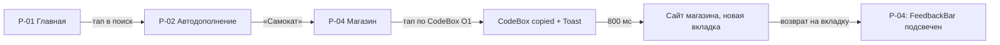
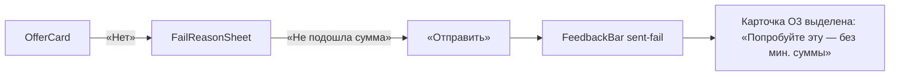
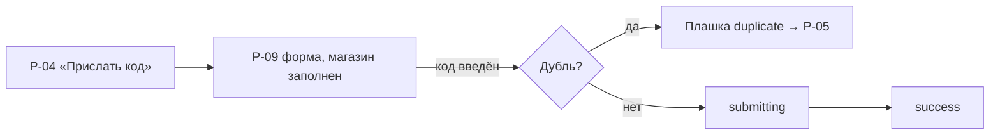

# Design Spec: веб-сервис проверенных промокодов и бесплатных офферов

Версия 0.2, 11.11.2026. Основа: [ARD.md](ARD.md); ID требований (F-, C-, N-, D-, S-, L-) отсылают к нему.
Визуальный стиль — по референсу [`design/reference-filko.png`](design/reference-filko.png) (дашборд Filko): тёплый кремовый фон, плоские бежевые блоки без теней, почти чёрные кнопки со стрелкой ↗, жёлтый и фиолетовый акценты, линейные иллюстрации. Ниже он переложен на наш продукт и дополнен тёмной темой (1.11).
Цель документа: по нему можно собрать макеты в Figma без дополнительных решений. Всё, что нужно нарисовать, перечислено: фреймы, блоки сверху вниз, тексты, компоненты, варианты и состояния.

Рабочее название продукта: **«Рабочий код»**. Заменяется в одном месте: компонент `Logo`.

**Логотип.** Знак `Logo/mark` 32 × 32: купон (квадрат `radius-md` с полукруглыми вырезами 4 px по бокам) с заливкой `primary` и жёлтой галочкой `highlight` (обводка 3, скругление) — «код, который проверен». Рядом словесный знак: «Рабочий» стилем `h2` + «код» стилем `logo/code` (JetBrains Mono Bold 22/28, −3%) — тем же моноширинным шрифтом, что и промокоды. Отступ между знаком и текстом 10. В Dark знак светлый (инверсия `primary`), галочка остаётся жёлтой. Отдельно `Logo/mark` — favicon, аватар бота, минимальный размер 16.

---

## 0. Как пользоваться документом

### 0.1. Структура Figma-файла
Файл на бесплатном тарифе Figma: не больше 3 страниц и один режим на коллекцию переменных. Поэтому:

| Страница Figma | Содержимое |
|---|---|
| `01 Foundations` | цвета Light и Dark, типографика (Text Styles), образцы |
| `02 Components` | все компоненты раздела 3 на доске `Components`, секции по группам; иконки, иллюстрации, логотипы `Brand/*` |
| `03 Screens` | фреймы страниц: ряд на страницу (P-01, P-04, …); слева mobile 360 × auto, справа desktop 1440 × auto, правее — состояния |
| `05 Flows` | сценарии раздела 5: клоны экранов со стрелками |
| `99 Отложено: подписки, корзина, бот` | макеты отложенных функций (раздел 8); в разработку не передаются |

- Цвета: коллекция `color` (Light, к ней привязаны все макеты) и коллекция `color-dark` с переменными `dark/<токен>`. Тёмный макет — копия фрейма с перепривязкой на `dark/*`; переключения режимом нет.
- Сценарии раздела 5 раскладываются на странице `05 Flows`.

### 0.2. Именование
- Фрейм страницы: `P-04 Merchant / Mobile / Default`, `P-04 Merchant / Mobile / Empty`.
- Компонент: `OfferCard`, свойства варианта — с маленькой буквы: `type=code`, `verification=high`, `ad=true`.
- Слои внутри компонента — по смыслу: `title`, `code`, `meta`, не `Frame 12`.
- Все контейнеры — Auto Layout. Фиксированная ширина только у фрейма страницы.

### 0.3. Приоритеты отрисовки
1. P0: P-01, P-02, P-04, P-05, P-09, P-11, P-12 + все компоненты, которые они используют.
2. P1: P-06 Каталог, P-08.
3. P2-фичи (история оффера, сравнение выгоды, голосование) отмечены в тексте как `[P2]`: рисуются последними или не рисуются.

---

## 1. Foundations

### 1.1. Брейкпоинты и сетка
| Брейкпоинт | Фрейм в Figma | Колонки | Поля | Gutter | Ширина контента |
|---|---|---|---|---|---|
| Mobile | 360 × auto | 4 | 16 | 12 | 328 |
| Tablet | 768 × auto | 8 | 24 | 16 | 720 |
| Desktop | 1440 × auto | боковая панель 240 + контент 12 колонок | 32 | 24 | 1136 (1440 − 240 − 2 × 32) |

Tablet в MVP не рисуется: верстается как растянутый mobile до 1024, дальше desktop.
Desktop, как в референсе: слева фиксированная боковая панель `Sidebar` на всю высоту, отделённая вертикальной линией `border`; справа сверху строка `Topbar` (поиск слева, чипы справа), под ней контент.

### 1.2. Отступы
Шаг 4. Токены: `space-1` 4, `space-2` 8, `space-3` 12, `space-4` 16, `space-5` 20, `space-6` 24, `space-8` 32, `space-10` 40, `space-12` 48, `space-16` 64.
- Внутренний отступ карточки: 16 (mobile), 20 (desktop).
- Между карточками в списке: 12.
- Между секциями страницы: 32 (mobile), 48 (desktop).

### 1.3. Радиусы и тени
Стиль плоский и почти прямоугольный: блоки различаются заливкой, а не тенью.

| Токен | Значение | Где |
|---|---|---|
| `radius-sm` | 2 | теги, бейджи, чипы |
| `radius-md` | 4 | кнопки, поля ввода, поле кода, карточки, плитки, аватар магазина |
| `radius-xl` | 16 | только верхние углы bottom sheet на mobile |
| `radius-full` | 999 | точка в теге, аватары пользователей, переключатели |
| `shadow-overlay` | Light: 0 12 32 rgba(28,26,22,.14); Dark: нет, вместо тени обводка 1 px `border-strong` | sheet, модалка, тост, выпадающие списки |

Карточки, плитки, шапка и боковая панель теней не имеют.

### 1.4. Типографика
Шрифты (Google Fonts, полная кириллица): **Inter Tight** — крупные заголовки и выгода, **Inter** — интерфейс, **JetBrains Mono** — только промокоды.
Заголовки, как в референсе, крупные и нежирные (500) с плотным трекингом; жирность 600 — только для коротких подписей и кнопок.

| Стиль | Шрифт | Размер / межстрочный | Начертание | Трекинг | Где |
|---|---|---|---|---|---|
| `display` | Inter Tight | 48 / 52 (mobile 32 / 36) | 500 | −2% | заголовок главной, hero |
| `h1` | Inter Tight | 32 / 38 (mobile 26 / 32) | 500 | −1.5% | заголовок страницы |
| `h2` | Inter Tight | 22 / 28 | 500 | −1% | заголовок секции («Проверено сегодня») |
| `tile` | Inter Tight | 20 / 22 | 500 | −1% | подпись цветной плитки категории |
| `value` | Inter Tight | 22 / 26 | 600 | −1% | выгода на карточке («−300 ₽») |
| `title` | Inter | 16 / 22 | 600 | 0 | название магазина, заголовок карточки |
| `body` | Inter | 15 / 22 | 400 | 0 | основной текст |
| `body-sm` | Inter | 13 / 18 | 400 | 0 | условия, описания (как описания уроков в референсе) |
| `caption` | Inter | 12 / 16 | 500 | 0 | мета («Проверено 2 ч назад»), теги, номера плиток «01» |
| `overline` | Inter | 12 / 16 | 500 | 0 | подпись над заголовком блока («Модуль 6» в референсе → «Самокат · 4 оффера») |
| `code` | JetBrains Mono | 18 / 24 | 600 | +3% | промокод |
| `button` | Inter | 14 / 20 | 600 | 0 | кнопки |

Минимальный размер текста — 12. Тексты условий никогда не меньше `body-sm`.

### 1.5. Цвета (Figma Variables, коллекция `color`, режимы Light / Dark)
Палитра Light снята пипеткой с референса; оттенки текста, статусов и фиолетового подобраны так, чтобы проходить контраст (1.9).

| Токен | Light | Dark | Назначение |
|---|---|---|---|
| `bg` | #FDF8EC | #14130F | фон страницы и боковой панели (кремовый / тёплый почти чёрный) |
| `surface-1` | #EEE8D4 | #221F18 | бежевые блоки: карточки, hero, чипы в `Topbar` |
| `surface-2` | #FFFFFF | #2D2920 | вкладыши внутри блоков: поле кода, теги, поля ввода |
| `neutral-bg` | #E3DCC5 | #38322A | скелетоны, бейджи «Под вопросом», «Завершён», трек прогресса |
| `border` | #E6DFCB | #38332A | разделители, вертикальная линия боковой панели |
| `border-strong` | #1C1A16 | #F3EDDD | обводка квадратных иконок таймлайна, фокус, обводка оверлеев в Dark |
| `text` | #1C1A16 | #F3EDDD | основной текст |
| `text-muted` | #5F5B52 | #B3AB98 | мета, описания, пункты меню |
| `text-disabled` | #A39E90 | #6E685A | завершённые офферы |
| `primary` | #2C2C2A | #F3EDDD | главные кнопки, выбранные чипы, активные элементы (в Dark — инверсия: светлая кнопка) |
| `on-primary` | #FDF8EC | #1C1A16 | текст и иконка на `primary` |
| `accent` | #7A57AE | #9B7BD0 | фиолетовый: иконки меню, прогресс, ссылки, плитка «03» |
| `accent-text` | #7A57AE | #C3A8F0 | фиолетовый текст (ссылки) |
| `on-accent` | #FFFFFF | #1C1A16 | текст на заливке `accent` |
| `highlight` | #FFBA1B | #FFBA1B | жёлтый: плитка «02», промо-блоки, отметки таймлайна, декоративные линии |
| `on-highlight` | #1C1A16 | #1C1A16 | текст на `highlight` |
| `success` | #2E6B3F | #86C99A | высокий шанс, «Сработал», «Доступно из РФ» |
| `success-bg` | #DDEBD3 | #1F3326 | фон бейджа success |
| `warning` | #9A4A00 | #F0A35E | ограничения в условиях, «Есть подвох» |
| `warning-bg` | #FBE2BF | #3B2614 | фон ограничений |
| `danger` | #B3261E | #FF8A80 | «Не сработал», «Недоступно из РФ», ошибки |
| `danger-bg` | #F8D9D3 | #3E1D1A | фон бейджа danger |
| `dot-red` / `dot-yellow` / `dot-purple` / `dot-green` | #FA4442 / #FFBA1B / #7A57AE / #2E6B3F | #FF6B66 / #FFBA1B / #9B7BD0 / #86C99A | точки в тегах (как «● Group» в референсе) |
| `ad` | #6B675D | #A39C8A | метка «Реклама» |

Правила:
- Цвет никогда не единственный носитель смысла: у каждого статусного бейджа есть иконка и текст.
- `highlight` и `accent` — акценты, а не фон страниц: на экране максимум 2–3 жёлто-фиолетовых блока (как в референсе: три плитки и один промо-блок).
- Жёлтый не используется для статуса «предупреждение», чтобы не путать акцент с ограничением: у ограничений свой `warning` (коричнево-оранжевый) с иконкой.

### 1.6. Иконки
Набор **Lucide**, контурные, stroke 1.5 (как в референсе), 20 px в меню и кнопках, 16 px в тегах и условиях. Иконки пунктов `Sidebar` — цвет `accent`, остальные — цвет текста рядом.
Используемые иконки:
`search`, `x`, `menu`, `chevron-right`, `chevron-down`, `arrow-up-right` (стрелка в кнопках), `copy`, `check`, `external-link`, `shield-check` (проверено), `clock` (срок), `thumbs-up`, `thumbs-down`, `alert-triangle` (подвох/ограничение), `info`, `bell`, `bell-ring`, `send` (бот), `filter`, `arrow-up-down` (сортировка), `globe` (регион), `credit-card`, `smartphone`, `id-card` (KYC), `graduation-cap`, `building-2` (юрлицо), `gift` (бесплатно), `percent` (скидка), `ticket` (промокод), `wallet` (кешбэк), `wifi-off`, `home`, `layout-grid` (категории), `zap` (промо-блок), `history` `[P2]`.
Дополнительно: `shield` (средний шанс), `help-circle` (под вопросом / не проверен), `x-circle` (завершён), `at-sign` (корпоративная почта).
В актуальных версиях Lucide часть иконок переименована (`alert-triangle` → `triangle-alert`, `help-circle` → `circle-help`, `x-circle` → `circle-x`); в Figma-плагине Lucide искать по любому из имён.

### 1.7. Движение
- Длительность: 150 мс (нажатия, бейджи), 250 мс (sheet, модалка), easing `ease-out`.
- Скопирован код: плашка кода на 150 мс заливается `success-bg`, иконка `copy` меняется на `check`, держится 2 с.
- Наведение на цветную плитку (desktop): сдвиг иллюстрации вверх на 4 px.
- При `prefers-reduced-motion` анимации заменяются мгновенной сменой состояния.

### 1.8. Доступность
- Тап-зона ≥ 44 × 44 (кнопки, чипы, иконки-кнопки — через padding).
- Фокус: обводка 2 px `border-strong` + отступ 2 px, у всех интерактивных элементов, рисуется как вариант `state=focus`.
- Все иконки-кнопки имеют текстовую подпись для скринридера (в Figma — в описании компонента).
- Код в плашке озвучивается посимвольно: в описании компонента `CodeBox` указать «aria-label: Промокод S A M O K A T 3 0 0, кнопка, скопировать».
- Иллюстрации декоративные: `alt=""`.

### 1.9. Контраст ключевых пар
Посчитано по формуле WCAG 2.x для значений из 1.5. Требование: ≥ 4.5:1 для текста, ≥ 3:1 для иконок, обводок и крупного текста (≥ 24 px или ≥ 18.66 px жирным).

| Текст / фон | Light | Dark |
|---|---|---|
| `text` / `bg` | 16.39 | 15.90 |
| `text` / `surface-1` | 14.17 | 14.07 |
| `text` / `surface-2` | 17.37 | 12.40 |
| `text-muted` / `bg` | 6.38 | 8.14 |
| `text-muted` / `surface-1` | 5.52 | 7.20 |
| `text-muted` / `surface-2` | 6.76 | 6.34 |
| `text-muted` / `neutral-bg` | 4.93 | 5.55 |
| `on-primary` / `primary` | 13.20 | 14.87 |
| `primary` / `surface-1` | 11.41 | 14.07 |
| `accent-text` / `bg` | 5.21 | 9.01 |
| `accent-text` / `surface-1` | 4.51 | 7.97 |
| `accent` (иконки) / `surface-1` | 4.51 | 4.81 |
| `on-accent` / `accent` | 5.52 | 5.08 |
| `on-highlight` / `highlight` | 10.17 | 10.17 |
| `success` / `surface-1` | 5.20 | 8.48 |
| `success` / `success-bg` | 5.13 | 6.95 |
| `warning` / `surface-1` | 5.11 | 7.91 |
| `warning` / `warning-bg` | 4.99 | 6.86 |
| `danger` / `surface-1` | 5.33 | 7.20 |
| `danger` / `danger-bg` | 4.94 | 6.59 |
| `ad` / `surface-1` | 4.60 | 6.01 |
| `text-disabled` / `surface-1` | 2.18 | 2.97 |

`text-disabled` ниже 4.5 намеренно: им пишутся только неактивные элементы завершённых офферов (код, выгода). Значимый текст на таких карточках («Завершён 01.11.2026») пишется `text-muted`.
Фиолетовый референса #8966BB затемнён до #7A57AE: с исходным белый текст на плитке давал 4.49, с новым — 5.52.

### 1.10. Визуальный язык (из референса)
| Приём в референсе | Как применяем у нас |
|---|---|
| Кремовый фон, бежевые плоские блоки, никаких теней | `bg` + `surface-1`; карточки офферов — бежевые прямоугольники `radius-md` без обводки и тени |
| Почти чёрная кнопка с текстом и стрелкой ↗ («View Progress») | `Button variant=primary`: заливка `primary`, справа иконка `arrow-up-right`; так выглядят все внешние переходы («Скопировать и открыть Самокат ↗») |
| Белая кнопка на жёлтом («Upgrade Now ↗») | `Button variant=on-highlight`: заливка `surface-2`, текст `text`, та же стрелка; только внутри жёлтых блоков |
| Три пронумерованные цветные плитки с линейными иллюстрациями («01 Going shopping») | `CategoryTile` (3.7): «01 Еда и продукты» (светлая), «02 Маркетплейсы» (жёлтая), «03 Бесплатно» (фиолетовая) в hero главной |
| Hero-блок на бежевом: приветствие мелко, крупный заголовок в 3 строки, кнопка | hero главной: `overline` «Сегодня проверено 1 240 кодов», `display` в 2–3 строки, поиск и кнопка |
| Боковое меню с фиолетовыми контурными иконками, активный пункт — заливка иконки | `Sidebar` на desktop, `MenuDrawer` на mobile |
| Чипы в правом верху (XP, дни) на бежевом | `TopbarChip`: «✓ 1 240 проверено сегодня», «🔔 2 подписки» (иконки Lucide, не эмодзи) |
| Таймлайн уроков: квадратные иконки 28 px в обводке, жёлтые кружки-галочки, вертикальная жёлтая линия, справа серое описание | `StepList` (3.33): шаги «Как применить код», «Как мы проверяем», история оффера `[P2]` |
| Прогресс-бар фиолетовый на бежевом треке + «75%» справа | `ScoreBar` (3.13): «Сработал у 41 из 47» |
| Карточки расписания: бежевые, заголовок + серая строка + белый тег с цветной точкой справа внизу | `OfferCard density=compact` и тег источника `Tag` («● Партнёр», «● Пользователь») |
| Жёлтый промо-блок в углу меню с иконкой-молнией и белой кнопкой («Your Level Up with Plus») | `PromoBlock` (3.34): «Знаете код? Пришлите — проверим» в `Sidebar` и на главной (mobile) |
| Тонкие жёлтые декоративные дуги поверх фона | `Decor/arc`: 1–2 дуги 1.5 px `highlight` в hero главной и на пустых состояниях; не пересекают текст |
| Линейные иллюстрации: чёрный контур 1.5 px + плоские заливки жёлтым и фиолетовым | набор `Illustration/*` (3.35): пакет еды, коробка, облако, монеты, лупа, пустая корзина |

### 1.11. Тёмная тема: правила адаптации
Референс есть только в светлом варианте; тёмная тема строится по правилам ниже, а не инверсией цветов.
1. **Тёплый, а не синий тёмный.** Фон `#14130F`, блоки `#221F18`, вкладыши `#2D2920` — оттенки того же кремово-бежевого тона, что и Light. Чистый чёрный и холодный серый не используются.
2. **Иерархия глубины та же:** `bg` (самый тёмный) → `surface-1` → `surface-2` (самый светлый). В Light вкладыш белый на бежевом, в Dark — светлее блока на шаг.
3. **Главная кнопка инвертируется:** светло-кремовая `#F3EDDD` с тёмным текстом — так она остаётся самым контрастным элементом, как чёрная кнопка в Light.
4. **Жёлтый не меняется** (`#FFBA1B`): на тёмном он и так контрастен (10.88 к `bg`). Текст на жёлтом всегда тёмный.
5. **Фиолетовый светлеет** (`#9B7BD0`), текст на нём становится тёмным (`on-accent` = `#1C1A16`, 5.08:1), ссылки — ещё светлее (`#C3A8F0`).
6. **Статусы светлеют, фоны статусов темнеют:** зелёный, оранжевый и красный подняты до ≥ 6.5:1 на своих фонах.
7. **Плитки категорий:** светлая плитка «01» в Dark — `surface-2`; «02» остаётся жёлтой, «03» — фиолетовой `accent`. Чтобы три плитки не «выжигали» тёмный экран, заливка жёлтой и фиолетовой плиток занимает не больше 30% ширины hero на desktop и одну плитку в зоне видимости на mobile (карусель).
8. **Иллюстрации:** контур меняется с `#1C1A16` на `#F3EDDD`, заливки жёлтым и фиолетовым те же; белые заливки внутри иллюстраций заменяются на `surface-2`. Делать иллюстрации компонентами с вариантом `theme=light|dark` или красить контур переменной `border-strong`.
9. **Тени не используются;** оверлеи (sheet, модалка, тост, выпадающий список) отделяются обводкой 1 px `border-strong` с прозрачностью 24% и подложкой `rgba(0,0,0,.6)`.
10. **Декоративные дуги** в Dark — `highlight` с прозрачностью 60%.
11. **Логотипы магазинов** лежат на `surface-2` (Light — белом) в обеих темах; в Dark добавить внутренний отступ 4 px, чтобы тёмные логотипы не сливались.
12. Переключение: по умолчанию тема системы; ручной выбор в `Sidebar` / `MenuDrawer` — «Системная / Светлая / Тёмная».

### 1.12. Второй референс: что берём
[`design/reference-nestvested.png`](design/reference-nestvested.png) (карточка заявки Nestvested) — строгий «документный» интерфейс. Цвета и шрифты из него не берём, только приёмы подачи данных:

| Приём в референсе | Как применяем у нас |
|---|---|
| Ряд крупных цифр с подписями сверху и тонкими вертикальными разделителями («Disp. Income $210,000.00 \| Monthly payment …») | `StatStrip` (3.37): на странице оффера «Выгода −300 ₽ \| Мин. заказ 1 500 ₽ \| Шанс 86 \| Сработал 41/47 \| До 30.11» |
| Сегментированная шкала риска: 10 серых делений, одно подсвечено | `ScoreBar variant=segmented` (3.13): 10 делений, закрашено по шансу (86 → 9 делений), цвет по уровню |
| Статус-пилюля «● Loan Approved» над заголовком | `Tag tone=success` над выгодой: «● Проверен 2 ч назад» |
| Мета справа вверху: «Applied on: …», «Loan Duration: …» | правый верхний угол страницы оффера: «Проверено: 11.11.2026, 14:20», «Действует до: 30.11.2026» |
| Сетка «подпись мелко сверху → значение ниже», ячейки разделены тонкими линиями | `KeyValueGrid` (3.38): условия на странице оффера и бесплатного оффера, «Как мы проверяем» |
| Левое якорное меню разделов с вертикальной чертой у активного пункта | `AnchorNav` (3.39): на desktop у страниц P-05, P-08, P-11 |
| Ссылка справа от заголовка секции («What's Included?») | `SectionHeader` с ссылкой-пояснением: «Почему такой шанс?» |
| «← Back to All Applicants» | `BackLink` (3.41): «← Все коды Самоката» |
| Переключатель Light / Dark прямо в верхней строке | `ThemeToggle` (3.40) в `Topbar` на desktop |
| Тёмная боковая панель: структура держится на тонких линиях-разделителях и мелких чипах, а не на заливках | правило для Dark (1.11 п. 13) |
| Подчёркнутые ссылки со стрелкой («Visit Profile →») | все текстовые ссылки: подчёркивание 1 px, отступ подчёркивания 3 px, стрелка `→` или `↗` для внешних |

Дополнение к 1.11:
13. **В тёмной теме плотные данные разделяются линиями, а не заливками.** `KeyValueGrid`, `StatStrip`, списки в `Sidebar` — на `bg` с разделителями 1 px `border`; бежевые заливки `surface-1` остаются только у карточек офферов и hero. Так тёмный экран не превращается в набор серых прямоугольников (приём тёмной панели второго референса).

---

## 2. Тестовые данные для макетов

Во всех макетах использовать одни и те же данные, чтобы состояния были сравнимы.

### 2.1. Магазины
Магазины и сервисы (провайдеры бесплатных офферов) — одна сущность: у обоих есть страница, плитка `MerchantTile` и офферы в `OfferCard`.

| Магазин или сервис | Категория | Офферов |
|---|---|---|
| Самокат | Еда и продукты | 4 |
| Яндекс Еда | Еда и продукты | 3 |
| Ozon | Маркетплейсы | 5 |
| Wildberries | Маркетплейсы | 2 |
| Литрес | Подписки | 1 |
| Ламода | Одежда | 0 (для пустого состояния) |
| Yandex Cloud | Бесплатно › Облака и VPS | 1 |
| GitHub Student Pack | Бесплатно › Студентам | 1 |
| Cloudflare | Бесплатно › Хостинг | 1 |
| Timeweb Cloud | Бесплатно › Облака и VPS | 2 |
| Перекрёсток | Еда и продукты | 3 |
| Купер | Еда и продукты | 2 |
| Мегамаркет | Маркетплейсы | 4 |

### 2.2. Офферы
| # | Магазин | Тип | Выгода | Код | Условия | Шанс | Отзывы 7 дн | Проверено | Источник | Реклама |
|---|---|---|---|---|---|---|---|---|---|---|
| O1 | Самокат | промокод | −300 ₽ | SAMOKAT300 | от 1 500 ₽; первый заказ; не суммируется с баллами; только в приложении; до 30.11.2026 | 86 | 41 из 47 | 2 ч назад | партнёрская сеть | да, erid 2VtzqvXYZ12 |
| O2 | Самокат | промокод | −15% | VKUSNO15 | от 2 000 ₽; только категория «Готовая еда»; до 20.11.2026 | 58 | 7 из 12 | вчера | пользователь | нет |
| O3 | Самокат | акция | 2 по цене 1 | — | молочные продукты по вторникам; до 31.12.2026 | 74 | 12 из 15 | 5 ч назад | сайт магазина | нет |
| O4 | Самокат | промокод | −500 ₽ | SAMO500 | от 3 000 ₽ | 22 | 3 из 14 | 3 дня назад | пользователь | нет |
| O5 | Самокат | промокод | −200 ₽ | AUTUMN200 | завершён 01.11.2026 | — | — | — | партнёрская сеть | нет |
| O6 | Ozon | промокод | −1 000 ₽ | OZON1000 | от 5 000 ₽; электроника; один код на заказ; до 15.11.2026 | 79 | 22 из 27 | 40 мин назад | партнёрская сеть | да |
| O7 | Яндекс Еда | промокод | −25% до 500 ₽ | EDA25 | первый заказ | 81 | 18 из 22 | 1 ч назад | партнёрская сеть | да |

### 2.3. Бесплатные офферы
| # | Провайдер | Тип | Выгода | Доступно из РФ | Требуется | После окончания | Подвох | Проверено |
|---|---|---|---|---|---|---|---|---|
| F1 | Yandex Cloud | кредит | ≥ 4 000 ₽ на 60 дней | да | карта РФ при создании платёжного аккаунта | потребление становится платным | не тратится на GPU и Marketplace | 11.11.2026 |
| F2 | Cloudflare | free tier | DNS, CDN, Workers 100 000 запросов/день | частично: сайт за Cloudflare может замедляться у пользователей из РФ | email | бесплатно бессрочно | лимит 10 мс CPU на запрос | 29.10.2026 |
| F3 | AWS | кредит | до $200 на 6 месяцев | нет: регистрация из РФ закрыта с 03.2022 | зарубежная карта, телефон | аккаунт закрывается через 6 мес. | только избранные сервисы | 08.11.2026 |
| F4 | GitHub Student Pack | студентам | 80+ офферов на 2 года | да | подтверждение статуса студента | доступ кончается после 2 лет | у партнёров свои условия | 05.11.2026 |

---

## 3. Компоненты

Формат: назначение → анатомия (слои сверху вниз / слева направо) → свойства варианта → состояния.

### 3.1. `Header` (mobile), `Sidebar` и `Topbar` (desktop)
Назначение: навигация и поиск на всех страницах.

**`Header` — mobile, высота 56.** Фон `bg`, нижняя граница `border`. `Logo` слева (`h2`, 500, как «Filko» в референсе); справа иконки-кнопки `search` и `menu`.
Варианты: `search=collapsed|expanded` (при `expanded` логотип скрыт, поле на всю ширину, справа «Отмена»). На главной иконка `search` скрыта: поле уже есть в первом экране.

**`Sidebar` — desktop, ширина 240, на всю высоту, фиксирована.** Фон `bg`, справа вертикальная линия 1 px `border`. Сверху вниз:
1. `Logo`, отступ 32 сверху и слева.
2. Меню (отступ 48 от логотипа), пункты высотой 40, иконка 20 `accent` + текст `body` `text-muted`:
   «Главная» (`home`), «Каталог» (`layout-grid`), «Прислать код» (`send`), «Как мы проверяем» (`shield-check`). Отдельного пункта «Бесплатно» нет: это ветка каталога.
   Активный пункт: текст `text` 500, иконка с заливкой `accent` (как «Dashboard» в референсе).
3. Сразу под меню (отступ 48, без растяжки до низа панели), поля 24: `PromoBlock` (3.34) «Знаете код?».

**`Topbar` — desktop, высота 72, над контентом.** Слева `SearchField size=md` без обводки, на фоне `bg`, шириной 480 (как «Search for a course…»); справа `TopbarChip` и `ThemeToggle` (3.40).
`TopbarChip`: высота 36, `surface-1`, `radius-md`, иконка 16 + `caption`: «`shield-check` 1 240 проверено сегодня».

### 3.2. `MenuDrawer` (mobile)
Выезжает справа, ширина 296, фон `bg`, `shadow-overlay`, затемнение подложки `rgba(28,26,22,.4)`. Пункты — как в `Sidebar`, внизу `PromoBlock`.
Пункты высотой 52; после разделителя — «Тема» с сегментированным переключателем «Системная / Светлая / Тёмная» (3.40).

### 3.3. `SearchField`
Анатомия: иконка `search` → поле ввода → кнопка `x` (только при непустом значении).
- Размеры: `size=lg` высота 56 (главная), `size=md` 44 (шапка).
- Плейсхолдер: «Магазин или сервис, например Самокат».
- Состояния: `default`, `focus` (обводка 2 px `border-strong`), `filled`, `disabled` не используется.

### 3.4. `AutocompleteList`
Выпадающий список под полем, `surface-2`, `shadow-overlay`, `radius-md`, максимум 6 строк.
Строка `AutocompleteItem` (высота 56): `MerchantAvatar size=32` → название (`title`, совпадение выделено 700) + под ним «4 проверенных оффера» (`caption`, `text-muted`) → `chevron-right`.
Варианты строки: `kind=merchant|category|query` («Искать „самок“ во всех офферах» с иконкой `search`).
Состояния списка: `results`, `loading` (3 скелетон-строки), `empty` («Ничего не нашли. Прислать код для „Самокат“?» + ссылка на P-09), `recent` (при пустом поле: заголовок «Вы искали» и до 5 последних запросов с `x` для удаления каждого).

### 3.5. `MerchantAvatar`
Квадрат `radius-md`, фон `surface-2`, логотип по центру с отступом 4; если логотипа нет — первая буква названия (`title`, `text-muted`). Размеры 24 / 32 / 48 / 64.
В макетах логотипы — стилизованные заглушки `Brand/*` (фирменный цвет + простой знак: Самокат, Яндекс Еда, Ozon, Wildberries, Литрес, Ламода, Yandex Cloud, GitHub); в продукте заменяются официальными логотипами из брендбуков. Свойства компонента: `showLogo=true|false`, `logo` (замена экземпляра `Brand/*`).

### 3.6. `MerchantTile`
Плитка в сетке популярных магазинов: фон `surface-1`, `radius-md`, padding 12: `MerchantAvatar 48` → название (`body-sm`, 600, 1 строка с обрезкой) → «4 оффера» (`caption`, `text-muted`). Ширина: mobile — 3 в ряд, desktop — 6 в ряд. Состояния: `default`, `hover` (фон `neutral-bg`), `pressed`, `focus`.

### 3.7. `CategoryChip`
Чип-ссылка: иконка 16 + текст `body-sm` 600, высота 36, `radius-sm`, фон `surface-1`. Категории MVP: «Еда и продукты», «Маркетплейсы», «Одежда», «Подписки», «Путешествия», «Облака и dev».

### 3.7a. `CategoryTile`
Цветная плитка категории по образцу «01 Going shopping». Размер: desktop 176 × 240, mobile 152 × 200. `radius-md`, без обводки.
Анатомия: номер `caption` («01») в левом верхнем углу, отступ 12 → ниже подпись `tile` в 2 строки («Еда и / продукты») → `Illustration` внизу, выходит за нижний край плитки (обрезается).
| Вариант `tone` | Фон | Текст | Иллюстрация |
|---|---|---|---|
| `light` | Light: #F7F2E8; Dark: `surface-2` | `text` | пакет с продуктами |
| `yellow` | `highlight` | `on-highlight` | коробка маркетплейса |
| `purple` | `accent` | `on-accent` | облако с монетой («Бесплатно») |
Состояния: `default`, `hover` (иллюстрация поднимается на 4 px), `focus`.

### 3.8. `FilterChip`
Переключаемый чип в строке фильтров, горизонтальная прокрутка на mobile.
- Варианты: `selected=false` (обводка `border`, текст `text`), `selected=true` (фон `primary`, текст `on-primary`, иконка `check` слева), `kind=toggle|dropdown` (у `dropdown` справа `chevron-down`, по тапу открывает `FilterSheet`).
- Первый чип всегда «Фильтры» с иконкой `filter` и счётчиком активных фильтров («Фильтры · 2»).

### 3.9. `FilterSheet`
Mobile: bottom sheet на 90% высоты; desktop: боковая панель 360 справа на странице магазина/категории.
Секции сверху вниз:
1. Заголовок «Фильтры» + кнопка `x`.
2. «Тип» — чипы мультивыбора: «Промокоды», «Акции», «Кешбэк».
3. «Для кого» — радио: «Все», «Только новым клиентам», «Подходит постоянным».
4. «Сумма заказа» — поле с числом «Моя сумма, ₽» и подсказка «Покажем только офферы, которые применятся к этой сумме».
5. «Надёжность» — переключатель «Скрыть офферы под вопросом».
6. Футер, прилипший к низу: «Сбросить» (текстовая кнопка) и «Показать 3 оффера» (`Button primary`, число пересчитывается).

В ветке каталога «Бесплатно» набор секций другой — см. 4.6.

### 3.10. `SortControl`
Текстовая кнопка `arrow-up-down` + текущая сортировка. По тапу — меню: «Сначала надёжные» (по умолчанию), «Сначала выгодные», «Сначала свежие», «Скоро закончатся».

### 3.11. `Button`
| Свойство | Значения |
|---|---|
| `variant` | `primary` (фон `primary`, текст `on-primary`, справа `arrow-up-right` у внешних переходов — как «View Progress ↗»), `on-highlight` (фон `surface-2`, текст `text`, стрелка; только внутри жёлтых блоков — как «Upgrade Now ↗»), `secondary` (обводка 1 px `border-strong`, фон прозрачный), `ghost` (без фона, текст подчёркнут), `danger-ghost` (текст `danger`) |
| `size` | `lg` 52, `md` 44, `sm` 36 |
| `icon` | `none`, `leading`, `trailing`, `only` |
| `state` | `default`, `pressed` (затемнение 8%), `focus`, `disabled` (40% прозрачности), `loading` (спиннер вместо текста, ширина сохраняется) |

### 3.12. `CodeBox` — плашка промокода
Ключевой элемент, тап по всей плашке копирует код (C-01).
- Анатомия: код (`code`, `text`) → справа иконка `copy` и подпись «Копировать» (`caption`). Фон `surface-2`, пунктирная обводка 1 px `border-strong` с прозрачностью 40%, `radius-md`, высота 52, ширина — по контейнеру.
- Состояния:
  - `default`;
  - `pressed` — фон темнее на 4%;
  - `copied` — фон `success-bg`, обводка сплошная `success`, иконка `check`, подпись «Скопировано» (держится 2 с, затем `default`);
  - `disabled` — для завершённых офферов: текст `text-disabled`, зачёркивание кода, иконка скрыта;
  - `focus`.
- Код никогда не скрывается и не размывается (принцип 8.1.4 ARD).

### 3.13. `ScoreBadge` — шанс сработать (C-04)
Анатомия: иконка + число + подпись. Высота 28, `radius-sm`.
| Вариант `level` | Условие | Фон / текст | Иконка | Текст |
|---|---|---|---|---|
| `high` | 70–100 | `success-bg` / `success` | `shield-check` | «86 · Высокий шанс» |
| `medium` | 40–69 | `warning-bg` / `warning` | `shield` | «58 · Средний шанс» |
| `low` | 0–39 | `neutral-bg` / `text-muted` | `help-circle` | «Под вопросом» |
| `unknown` | нет данных | `neutral-bg` / `text-muted` | `help-circle` | «Ещё не проверен» |
| `ended` | оффер завершён | `neutral-bg` / `text-muted` | `x-circle` | «Завершён» |

По тапу на бейдж — `Tooltip` (desktop) или маленький sheet (mobile): «Шанс считается по отзывам за 7 дней, способу и свежести проверки. Как мы проверяем →».

**`ScoreBar`** — шкала шанса, два варианта:
- `variant=progress` (как прогресс модуля в референсе 1): трек 80 × 6 из 10 сегментов по 8 px без зазора; закрашено `round(доля сработавших × 10)` сегментов цветом уровня (`success` / `warning` / `text-muted`), остальные `neutral-bg`; справа `caption` «41 из 47». Сегменты вместо непрерывной заливки — потому что ширину слоя в экземпляре Figma менять нельзя, а цвет сегмента можно. Используется в карточке.
- `variant=segmented` (как шкала риска в референсе 2): 10 делений 24 × 8 с зазором 2; закрашено `round(score / 10)` делений цветом уровня, остальные `neutral-bg`; над шкалой `caption` `text-muted` «Шанс сработать», справа от шкалы число `h2` «86». Используется на странице оффера.

### 3.14. `VerifiedMeta`
Строка `caption`, `text-muted`: «✓ 41 из 47 за 7 дней · Проверено 2 ч назад · партнёрская сеть».
Варианты источника проверки (C-03): «партнёрская сеть», «тест в корзине» `[P2]`, «отзывы пользователей», «редакция».
Форматы времени: «только что» (< 1 мин), «N мин назад», «N ч назад», «вчера», «N дня/дней назад» (до 6), дальше дата «03.11.2026». Если проверка старше 7 дней — текст `warning` и иконка `alert-triangle`.

### 3.15. `ConditionItem` и `ConditionList` (C-02)
`ConditionItem`: иконка 16 + текст `body-sm`.
| Вариант `kind` | Иконка | Цвет | Пример |
|---|---|---|---|
| `restriction` | `alert-triangle` | `warning` | «Только первый заказ», «От 1 500 ₽», «Не суммируется с баллами» |
| `neutral` | `info` | `text-muted` | «Только в приложении», «Для всех регионов» |
| `deadline` | `clock` | `text-muted`; `warning`, если ≤ 3 дней | «До 30.11.2026», «Осталось 2 дня» |

`ConditionList`: на карточке — 2 колонки на desktop, 1 колонка на mobile; максимум 4 пункта, дальше строка «+2 условия» (раскрывает список на месте, не переходя на детальную страницу). Порядок: сначала `restriction`, потом `deadline`, потом `neutral`.

### 3.16. `AdLabel` и `AdPopover` (C-07, L-01)
`AdLabel`: текст «Реклама» (`caption`, цвет `ad`) + иконка `info` 12. Позиция — правый верхний угол карточки. Показывается только у офферов с партнёрской ссылкой.
`AdPopover` (по тапу): «Реклама. ООО „Самокат“, ИНН 0000000000. erid: 2VtzqvXYZ12. Мы получаем комиссию, если вы купите по ссылке. На порядок офферов это не влияет.» + ссылка «Подробнее о рекламе» (на P-11, якорь «Реклама»).

### 3.17. `SourceLink` (C-06)
`caption`: «Источник: партнёрская сеть Admitad» / «Источник: сайт магазина ↗» / «Источник: прислал пользователь» / «Источник: канал-партнёр @name ↗». Ссылка открывается в новой вкладке, иконка `external-link`.

### 3.18. `FeedbackBar` (C-05)
Анатомия: подпись «Сработал?» (`body-sm`, `text-muted`) → `Button secondary sm icon=leading thumbs-up` «Да» → `Button secondary sm icon=leading thumbs-down` «Нет».
Состояния:
- `idle` — как выше;
- `sent-success` — вместо кнопок: иконка `check` `success` + «Спасибо! Учли в шансе сработать»; через 3 с остаётся «Вы отметили: сработал · Изменить»;
- `sent-fail` — «Спасибо, разберёмся. Причина: истёк · Изменить»;
- `disabled` — для завершённых офферов скрыт.
Нажатие «Нет» открывает `FailReasonSheet`.

### 3.19. `FailReasonSheet`
Bottom sheet (mobile) / поповер под кнопкой (desktop).
- Заголовок: «Что пошло не так?»
- Радио-список (одно значение): «Код истёк или не существует», «Не подошла сумма заказа», «Не подошли товары или категория», «Только для новых клиентов», «Не суммируется с другой скидкой», «Скидка меньше обещанной», «Другое».
- При «Другое» появляется поле «Коротко опишите» (до 200 символов, необязательно).
- Кнопка `primary` «Отправить» (неактивна, пока не выбрана причина).

### 3.20. `OfferCard` — единая карточка оффера
Одна карточка для всех офферов: промокодов, акций, кешбэка и бесплатных кредитов и тарифов (C-08). Отдельной карточки для бесплатных офферов нет: везде, где офферы стоят рядом (главная, поиск, каталог), они выглядят одинаково и различаются только содержимым слотов.
Ширина по контейнеру (минимум 328 у `density=full`), фон `surface-1`, `radius-md`, без обводки и тени, padding 16/20.

Анатомия сверху вниз:
1. Строка заголовка: `MerchantAvatar 32` + название магазина или сервиса (`title`) — только когда карточка вне страницы магазина (`context=feed`); справа `AdLabel` (если `ad=true`).
2. Выгода (`value`): «−300 ₽ на заказ от 1 500 ₽», «≥ 4 000 ₽ на 60 дней». Формула: «{выгода} {на что}». Запрещено «до 90%» без уточнения (C-10).
3. Слот действия:
   - `type=code` — `CodeBox`;
   - `type=sale` / `cashback` / `free` — строка механики с иконкой (`percent` «Скидка применится автоматически в корзине», `wallet` «Кешбэк вернётся в течение 30 дней», `gift` «Грант начислят после привязки платёжного аккаунта») + `Button secondary md` на всю ширину: «Перейти в магазин ↗» или «Получить на сайте ↗». У `free` с `availability=no` — «Подробнее об условиях ↗».
4. Строка доверия: у промокодов и акций `ScoreBadge` + `ScoreBar variant=progress`; у `type=free` на этом месте `AvailabilityBadge` (3.22).
5. Мета-строка `caption` `text-muted` («Проверено 2 ч назад · партнёрская сеть», у free — «Кредит · проверено 11.11.2026») + справа `Tag` источника («● Партнёр», «● Пользователь», «● Магазин», у free — «● Официально»).
6. `ConditionList`. У free сюда же попадают требования, подвох и что будет после окончания: «Нужна карта РФ» и «Не тратится на GPU и Marketplace» (`restriction`), «После 60 дней — платно» (`deadline`). `RequirementChip` и `GotchaNote` на карточке не используются — они остаются на P-08.
7. Разделитель `border`.
8. Футер: `FeedbackBar` «Сработал?» слева; справа `SourceLink` (desktop) или кнопка-иконка `chevron-right` 36 × 36 с обводкой и aria-label «Подробнее» (mobile: текстовая кнопка не помещается рядом с «Сработал? Да Нет»).

Свойства варианта:
| Свойство | Значения |
|---|---|
| `type` | `code`, `sale`, `cashback`, `free` (в Figma — булевы `code`, `mechanic`, `score`, `availability`) |
| `verification` | `high`, `medium`, `low`, `unknown`, `ended` (передаётся в `ScoreBadge`) |
| `availability` | `yes`, `partial`, `no` — только у `type=free` |
| `ad` | `true`, `false` |
| `context` | `merchant` (без строки магазина), `feed` (с магазином или сервисом) |
| `density` | `full`, `compact` (compact — как карточка расписания в референсе: строка магазина, выгода `title`, строка `body-sm` `text-muted` «SAMOKAT300 · шанс 86 · 2 ч назад» или «Доступно из РФ · нужна карта РФ · 11.11», `Tag` источника справа внизу; без слота действия, `ConditionList` и `FeedbackBar`, тап ведёт на P-05 или P-08; для «Проверено сегодня» на главной, «Другие офферы») |
| `state` | `default`, `copied` (CodeBox в `copied` + `Toast`), `feedback-sent` |

Правила по `verification`:
- `low` — карточка целиком, но над выгодой полоса `neutral-bg` с текстом «Много жалоб за неделю: 11 из 14 не сработали» (`caption`).
- `ended` — вся карточка в `text-disabled`, `CodeBox disabled`, вместо `FeedbackBar` строка «Завершён 01.11.2026». Такие карточки показываются только в свёрнутой секции «Завершённые».

Правило по `availability=no`: такие карточки скрыты фильтром «Доступно из РФ» по умолчанию (ARD 8.4).

Действие при копировании (C-01): копирование → `CodeBox copied` + `Toast` «Код скопирован. Открываем Самокат…» → через 800 мс открытие магазина в новой вкладке. Если пользователь в настройках не хочет автоперехода, ставится только тост с кнопкой «Открыть магазин» `[P1: настройка]`.

### 3.21. `FreeOfferCard` — удалён
Заменён `OfferCard type=free` (3.20).

### 3.22. `AvailabilityBadge`
| `availability` | Фон / текст | Иконка | Текст |
|---|---|---|---|
| `yes` | `success-bg` / `success` | `globe` | «Доступно из РФ» |
| `partial` | `warning-bg` / `warning` | `globe` | «Из РФ — с ограничениями» + причина строкой ниже |
| `no` | `danger-bg` / `danger` | `globe` | «Недоступно из РФ» + причина строкой ниже: «регистрация закрыта с 03.2022» |

### 3.23. `RequirementChip`
Высота 28, `radius-sm`, обводка `border`, иконка 16 + текст `caption`.
Значения: «Карта РФ» (`credit-card`), «Зарубежная карта» (`credit-card`, текст `danger`), «Телефон» (`smartphone`), «Подтверждение личности» (`id-card`), «Статус студента» (`graduation-cap`), «Юрлицо» (`building-2`), «Корпоративная почта» (`at-sign`), «Без карты» (`check`, `success`).

### 3.24. `GotchaNote`
Блок `warning-bg`, `radius-sm`, padding 12: иконка `alert-triangle` + заголовок «Есть подвох» (`body-sm` 600) + текст: «Грант не тратится на GPU и Marketplace».
Вариант `tone=neutral`: фон `neutral-bg`, иконка цвета `text`, заголовок скрыт (`showTitle=false`) — плашки «нет надёжных кодов» (P-04 `all-low`) и «оффер завершён» (P-05 `ended`).

### 3.25. `Toast`
Внизу экрана над безопасной зоной (mobile) / внизу слева от контента (desktop). Фон `primary`, текст `on-primary`, `radius-md`, высота 48, `shadow-overlay`, максимум 2 строки, опциональная кнопка-действие справа (текст `highlight`, подчёркнут). Исчезает через 4 с. Варианты: `info`, `success` (иконка `check`), `error` (иконка `alert-triangle`).

Уточнение 16.11.2026: 4 с активного показа; наведение, фокус внутри уведомления, swipe и скрытая/неактивная вкладка приостанавливают отсчёт. Снизу — линия `highlight` 2 px, линейно уменьшающаяся от полной ширины до нуля вместе с таймером. Справа — кнопка `x` с aria-label «Закрыть уведомление» и тап-зоной 44 × 44. Swipe перемещает карточку за указателем и закрывает её в направлении края экрана; короткий жест возвращает карточку на место. Появление и исчезновение — `opacity` + сдвиг 8 px, 150 мс `ease-out`. У бесконечных/loading-уведомлений и при `prefers-reduced-motion` декоративный timeline не показывается.

### 3.26. `EmptyState`
`Illustration` 160 × 120 (3.35) с одной декоративной дугой `highlight` → заголовок `h2` → текст `body` `text-muted` (до 2 строк) → 1–2 кнопки. Тексты заданы на каждой странице.

### 3.27. `ErrorState`
Как `EmptyState`, иконка `alert-triangle` `danger`, заголовок «Не удалось загрузить», текст «Проверьте интернет и попробуйте ещё раз», кнопка `secondary` «Повторить».

### 3.28. `Skeleton`
Прямоугольники `neutral-bg` со скруглением как у оригинала, анимация мерцания 1.2 с. Нарисовать скелетон для `OfferCard`, `FreeOfferCard`, `MerchantTile`, `AutocompleteItem`.

### 3.29. `OfflineBanner`
Полоса под шапкой, фон `warning-bg`, иконка `wifi-off`: «Нет соединения. Показываем сохранённые данные от 14:20». Копирование кодов работает, отзывы ставятся в очередь (тост «Отправим, когда появится связь»).

### 3.30. `SubscribeButton` — отложено (раздел 8)

### 3.31. `SectionHeader`
`h2` слева + справа ссылка `body-sm` `text-muted` «Все» (как «See all» в референсе) или ссылка-пояснение «Почему такой шанс?» (как «What's Included?»). Отступ снизу 16.

### 3.32. `Footer`
Фон `bg`, верхняя граница `border` (на desktop — внутри колонки контента, справа от `Sidebar`). Ссылки: «Как мы проверяем», «Реклама и партнёры», «Прислать код», «Политика конфиденциальности», «Контакты». Строка: «© 2026 Рабочий код. Мы получаем комиссию по части ссылок — они помечены „Реклама“».

### 3.33. `StepList` — таймлайн шагов
По образцу списка уроков в референсе 1. Каждый шаг — строка высотой 56:
- слева квадрат 28 × 28, обводка 1 px `border-strong`, фон `surface-2`, внутри иконка 16; у пройденных шагов в правом нижнем углу квадрата кружок 14 `highlight` с галочкой `text`; последний активный шаг — квадрат с заливкой `primary` и иконкой `on-primary`;
- квадраты соединены вертикальной линией 2 px `highlight`;
- справа от квадрата заголовок `title`; на desktop справа отдельной колонкой описание `body-sm` `text-muted` шириной 240.
Варианты: `state=done|current|upcoming` на шаг.
Где: «Как применить код» (P-04), «Как мы проверяем» (P-11), «Как получить» (P-08), история оффера `[P2]` (P-05).

### 3.34. `PromoBlock`
По образцу «Your Level Up with Plus». Фон `highlight`, `radius-md`, padding 16, ширина по контейнеру (в `Sidebar` — 192).
Анатомия: иконка `zap` 24 в круге 40 с обводкой `on-highlight` по центру сверху (выступает за верхний край на 50%) → заголовок `tile`, `on-highlight`, по центру: «Знаете код?» → `body-sm`: «Пришлите — проверим и опубликуем» → `Button variant=on-highlight sm` на всю ширину «Прислать код ↗».
Один вариант — `content=submit`.

### 3.35. `Illustration`
Линейные иллюстрации в стиле референса: контур 1.5 px `border-strong`, плоские заливки `highlight` и `accent`, белые части — `surface-2`. Компоненты с вариантом `theme=light|dark`.
Набор: `grocery-bag` (еда), `parcel` (маркетплейсы), `cloud-coin` (бесплатно), `magnifier` (поиск, 404), `empty-cart` (пустой магазин), `envelope-code` (прислать код), `bell-hand` (подписки), `plug` (офлайн/ошибка).
Источник: нарисовать вручную или собрать из открытых наборов линейных иллюстраций с совместимой лицензией; стиль — один контур, без градиентов и теней.

### 3.36. `Tag`
Белая плашка с цветной точкой (как «● Group», «● Loan Approved»). Высота 24, padding 8, `radius-sm`, фон `surface-2`, точка 6 × 6 `radius-full`, текст `caption` `text`.
| `tone` | Точка | Примеры |
|---|---|---|
| `partner` | `dot-purple` | «Партнёр» |
| `user` | `dot-yellow` | «Пользователь» |
| `merchant` | `dot-green` | «Магазин» |
| `success` | `dot-green`, фон `success-bg`, текст `success` | «Проверен 2 ч назад» |
| `danger` | `dot-red` | «Много жалоб» |

### 3.37. `StatStrip`
Ряд ключевых цифр по образцу верхней строки референса 2. Ячейки равной ширины, между ними вертикальная линия 1 px `border` высотой 100%; padding ячейки 0 16.
Ячейка: подпись `caption` `text-muted` сверху → отступ 24 → значение `h1` (Inter Tight 500), выровнено по нижнему краю ряда.
Mobile: горизонтальная прокрутка, видны 2,5 ячейки; значение `h2`.

### 3.38. `KeyValueGrid`
Сетка «подпись → значение» по образцу «Personal information». 2 колонки на desktop, 1 на mobile. Каждая ячейка: верхняя граница 1 px `border`, padding 8 0 12; подпись `caption` `text-muted`, значение `body` `text`.
Значение может быть ограничением: тогда перед ним иконка `alert-triangle` 16 `warning`.
Фон: Light — `bg` или `surface-1`; Dark — всегда `bg` (правило 1.11 п. 13).

### 3.39. `AnchorNav`
Только desktop. Колонка 200 слева от содержимого, прилипает при прокрутке. Пункты `body-sm` `text-muted`, высота 32; активный — `text`, слева вертикальная черта 2 px `border-strong` на всю высоту пункта; неактивные — черта 1 px `border`.

### 3.40. `ThemeToggle`
Подпись `caption` «Светлая» → переключатель 40 × 24 (`radius-full`, трек `neutral-bg`, ручка `surface-2`) → подпись «Тёмная»; активная подпись `text`, неактивная `text-muted`. Долгое нажатие / меню — «Как в системе». На mobile — сегментированный переключатель в `MenuDrawer` (3.2).

### 3.41. `BackLink`
`body-sm` `text` + иконка `arrow-left` 16 слева: «← Все коды Самоката». Подчёркивание при наведении.

### 3.42. `TextField`
Подпись `body-sm` 600 → поле высотой 52 (`surface-2`, `radius-md`, padding 0 12 0 16, обводка 1 px `border`) → подсказка `caption` `text-muted`.
- `kind=text|code`: у `code` значение шрифтом `code` (JetBrains Mono), ввод переводится в верхний регистр.
- `state=placeholder|filled|focus|error`: плейсхолдер `text-muted`; `focus` — обводка 2 px `border-strong`; `error` — обводка 1 px `danger`, подсказка `danger` с текстом ошибки.
- Свойства: `label`, `value`, `helper`, `showHelper`, `trailing` + `trailingIcon` (например, `calendar` у поля даты).

### 3.43. `Checkbox`
Квадрат 20 × 20 `radius-sm`: выключен — фон `surface-2`, обводка 1.5 px `border-strong`; включён — фон `primary`, иконка `check` 14 `on-primary`. Справа подпись `body`, отступ 12. Строка padding 10 0 — тап-зона ≥ 44. Длинная подпись переносится.

### 3.44. `Radio`
Как `Checkbox`, но круг 20: выбран — обводка 6 px `primary` (точка внутри — фон `surface-2`).

### 3.45. `SegmentedControl`
Трек `neutral-bg`, `radius-md`, padding 4, высота 44; сегменты равной ширины, `radius-sm`, подпись `body-sm` 600. Активный сегмент — фон `surface-2`, текст `text`; неактивный — без фона, `text-muted`. Вариант `active=1|2`.

---

## 4. Страницы

Формат каждой страницы: назначение и требования → URL → откуда приходят → блоки сверху вниз → состояния → взаимодействия → отличия desktop.

### 4.1. P-01 Главная · P0
**Назначение:** за 1 действие попасть к магазину (F-01), показать, что данные свежие.
**URL:** `/`
**Откуда:** прямой заход, поисковики.

**Mobile, сверху вниз:**
1. `Header device=mobile` (без иконки поиска).
2. Hero — бежевый блок `surface-1` во всю ширину, padding 20 16 24, одна декоративная дуга `highlight` в правом верхнем углу:
   - `overline` `text-muted`: «Сегодня проверено 1 240 кодов в 312 магазинах»;
   - `display` в 3 строки: «Промокоды, / которые правда / работают»;
   - `body`, `text-muted`: «Проверяем коды и показываем условия до того, как вы откроете корзину»;
   - `SearchField size=lg` на фоне `surface-2` (отступ 16 сверху);
   - карусель из трёх `CategoryTile` (01 Еда и продукты — `light`, 02 Маркетплейсы — `yellow`, 03 Бесплатно — `purple`), ширина плитки 152, видно 2 и край третьей.
3. Секция «Магазины и сервисы» — все магазины и сервисы одной группой, без деления на «магазины» и «бесплатное»: `SectionHeader` «Магазины и сервисы» / «Все» (ведёт в каталог); сетка `MerchantTile` 3 × 2 (Самокат, Яндекс Еда, Ozon, Wildberries, Литрес, Yandex Cloud).
4. Секция «Категории»: горизонтальная прокрутка `CategoryChip` (остальные категории, не попавшие в плитки).
5. Секция «Проверено сегодня»: `SectionHeader` «Проверено сегодня» / «Все»; подзаголовки-группы `caption` `text-muted` «Только что» и «Сегодня утром» (как «Today / Tomorrow» в референсе); под ними `OfferCard density=compact context=feed` (O6 — в «Только что»; O1, O3, F1 — в «Сегодня утром»). Бесплатные офферы идут в общей ленте, отдельной секции для них нет.
6. `PromoBlock content=submit` (на desktop его роль выполняет `PromoBlock` в `Sidebar`, здесь блок не рисуется).
7. `Footer`.

Деление по темам на главной — только плитки hero: они ведут в ветки каталога (`/catalog/food`, `/catalog/marketplaces`, `/catalog/free`).

Блока «Как мы проверяем» на главной нет: первый экран должен заинтересовать офферами, а не объяснять процесс. Объяснение — на P-11, туда ведут пункт меню и ссылка в футере.

**Состояния:**
| Состояние | Что меняется |
|---|---|
| `default` | как выше |
| `loading` | секции 3 и 5 — скелетоны; hero и поиск видны сразу |
| `search-focus` | при фокусе поля страница прокручивается так, чтобы поле было наверху; под полем `AutocompleteList state=recent` (или `results` при вводе) |
| `error` | секции 3 и 5 заменены одним `ErrorState`; поиск работает |
| `offline` | `OfflineBanner` под шапкой |

**Desktop:** `Sidebar` слева, `Topbar` сверху. Hero (`surface-1`, высота 320) в две части, как в референсе: слева `overline`, `display` в 3 строки, `SearchField` 400 и `Button primary` «Все магазины ↗» (ведёт в каталог); справа три `CategoryTile` 176 × 240 вплотную, третья обрезается правым краем экрана (выходит за окно на 48 px, подпись остаётся читаемой) — намёк, что плиток больше. Ниже две колонки, разделённые вертикальной линией `border`: слева (8 колонок) «Магазины и сервисы» сеткой 6 × 2 (второй ряд: GitHub, Перекрёсток, Cloudflare, Купер, Мегамаркет, Timeweb Cloud) и под ней «Категории» чипами; справа (4 колонки) «Проверено сегодня» лентой compact-карточек — как «Scheduled» в референсе.

### 4.2. P-02 Поиск (оверлей автодополнения) · P0
**Назначение:** найти магазин или сервис по первым буквам (F-01). Поиск один на всё: магазины, сервисы, промокоды, акции и бесплатные офферы.
**URL:** не меняется, оверлей; при выборе «Искать во всех офферах» — переход на P-03.
**Mobile:** полноэкранный слой: `Header search=expanded` (поле с фокусом, «Отмена» справа) → `AutocompleteList` на всю ширину без тени.
**Состояния:** `recent` (пустое поле), `loading`, `results` (ввод «сам»: «Самокат», «Самолёт: билеты» (категория), «Искать „сам“ во всех офферах»), `empty` (ввод «ламаода»: «Ничего не нашли» + «Возможно, вы имели в виду: Ламода» + «Прислать код»).
**Клавиатура (desktop):** ↑/↓ — выбор строки, Enter — переход, Esc — закрыть.

### 4.3. P-03 Результаты поиска · P1
**URL:** `/search?q=яндекс`
**Блоки:** `Header` → `h1` «Результаты по „яндекс“» + «2 магазина и сервиса · 2 оффера» → строка «Магазины и сервисы» (горизонтальный ряд `MerchantTile`: Яндекс Еда, Yandex Cloud) → строка `FilterChip` «Фильтры», «Промокоды», «Акции», «Бесплатно», «Новым клиентам» + `SortControl` → общий список `OfferCard context=feed` (O7 и F1 в одной ленте, одним видом карточки).
**Состояния:** `default`, `loading`, `empty` («По запросу ничего нет» + чипы популярных категорий), `error`.

### 4.4. P-04 Страница магазина · P0
**Назначение:** все офферы одного магазина, отсортированные по шансу (F-02, F-03).
**URL:** `/m/samokat`
**Откуда:** поиск, главная, категория, поисковики.

**Mobile, сверху вниз:**
1. `Header`.
2. Шапка магазина, padding 16:
   - `MerchantAvatar 64` + `h1` «Промокоды Самокат» + `caption` «4 активных оффера · обновлено 2 ч назад»;
   - `Button secondary sm icon=trailing external-link` «Сайт магазина».
3. Сводка — `StatStrip` из 3 ячеек: «Активных офферов / 4», «Лучшая выгода / −500 ₽», «Лучший шанс / 86».
4. Строка фильтров (прилипает под шапкой при прокрутке): `FilterChip` «Фильтры», «Промокоды», «Акции», «Новым клиентам», «Постоянным» с горизонтальной прокруткой; под ними строка: слева `caption` «4 оффера», справа `SortControl` (на 360 сортировка не помещается в одну строку с чипами).
5. Список `OfferCard context=merchant density=full`, порядок по умолчанию: O1 (86), O3 (74), O2 (58), O4 (22).
6. Свёрнутая секция «Завершённые (1)» → при раскрытии O5 `verification=ended`.
7. «Как применить код в Самокате» — `StepList` из 3–4 шагов, текст задаётся редакцией по магазину. Пример: «Соберите корзину в приложении» → «На экране оплаты нажмите „Промокод“» → «Вставьте код — скидка покажется в итоговой сумме».
8. Блок «Частые вопросы» (аккордеон, 3 вопроса), пример: «Можно ли применить два промокода?» — «Нет, в Самокате один код на заказ».
9. `PromoBlock content=submit` с текстом «Знаете код для Самоката?» (ведёт на P-09 с заполненным магазином).
10. `Footer`.

**Состояния:**
| Состояние | Что показываем |
|---|---|
| `default` | как выше |
| `loading` | шапка магазина видна (из кэша поиска), список — 3 скелетона `OfferCard` |
| `filtered-empty` | под фильтрами `EmptyState`: «Под эти фильтры ничего нет», кнопка «Сбросить фильтры» |
| `all-low` | все офферы `verification=low`: над списком `GotchaNote`-подобная плашка `neutral-bg`: «Сейчас у Самоката нет надёжных кодов. Ниже — коды с жалобами, пробуйте на свой риск» |
| `empty` (Ламода) | вместо списка `EmptyState`: иконка `ticket`, «Проверенных кодов сейчас нет», «Последний рабочий код был 28.10.2026. Знаете рабочий код — пришлите, проверим», кнопка «Прислать код ↗» |
| `copied` | `OfferCard state=copied` + `Toast` |
| `error`, `offline` | `ErrorState` вместо списка / `OfflineBanner` |
| `not-found` | P-12 404 |

**Desktop:** две колонки: слева шапка магазина (кнопка «Сайт магазина» справа в той же строке), `StatStrip size=desktop`, строка `FilterChip`, под ней `SortControl` справа (в одну строку с пятью чипами сортировка в колонку 744 не помещается), список; справа (360, прилипает) — карточка `surface-1` «Как применить код» и «Частые вопросы». «Прислать код» в правой колонке не дублируется: он уже есть в `PromoBlock` боковой панели. Условия на карточке пока в одну колонку. Фильтры — чипами сверху, полная форма `FilterSheet` — боковой панелью по клику на «Фильтры».

### 4.5. P-05 Детальная страница оффера · P0
**Назначение:** все условия, источник, отзывы, история; отдельный URL для ссылок и поисковиков.
**URL:** `/m/samokat/o/samokat300`
**Mobile:** открывается как полноэкранная страница при переходе по ссылке и как bottom sheet (90% высоты) по тапу «Подробнее» на P-04. Содержимое одинаковое.

**Блоки сверху вниз:**
1. `BackLink` «← Все коды Самоката» (только страница; в sheet — кнопка `x`).
2. Строка: `Tag tone=success` «Проверен 2 ч назад» слева; справа (desktop) мета в 2 строки `caption`: «Проверено: 11.11.2026, 14:20» / «Действует до: 30.11.2026».
3. `MerchantAvatar 48` + «Самокат» + `AdLabel`.
4. Выгода `display`: «−300 ₽ на заказ от 1 500 ₽».
5. `CodeBox` + `Button primary lg` на всю ширину «Скопировать и открыть Самокат ↗».
6. `StatStrip`: «Выгода / −300 ₽», «Мин. заказ / 1 500 ₽», «Сработал / 41 из 47», «Действует до / 30.11».
7. Блок доверия: `SectionHeader` «Надёжность» / ссылка «Почему такой шанс?» (открывает `ScoreBadge`-пояснение); `ScoreBar variant=segmented` (86 → 9 делений `success`); строки `body-sm`: «Проверено 2 ч назад через партнёрскую сеть», «Частые причины неудач: только первый заказ (4), сумма меньше 1 500 ₽ (2)».
8. «Условия» — `KeyValueGrid`: «Для кого / Только первый заказ ⚠», «Минимальная сумма / 1 500 ₽ ⚠», «Суммируется / Не суммируется с баллами ⚠», «Где применить / Только в мобильном приложении», «Регион / Вся Россия», «Срок / До 30.11.2026».
9. `FeedbackBar` крупно (кнопки `md`).
10. «Источник и реклама» — `KeyValueGrid`: «Источник / Партнёрская сеть Admitad», «Рекламодатель / ООО „Самокат“, ИНН 0000000000», «erid / 2VtzqvXYZ12» (если `ad=true`).
11. «История» `[P2]` — `StepList`: «01.11 — появился», «05.11 — мин. сумма изменилась с 1 000 до 1 500 ₽», «11.11 — проверен» (`current`).
12. «Другие офферы Самоката» — 2 `OfferCard density=compact` + «Все офферы →».

**Состояния:** `default`, `loading` (скелетон), `copied`, `feedback-sent`, `low` (`Tag tone=danger` «Много жалоб» вместо зелёного, шкала `text-muted`), `ended` (вверху плашка `neutral-bg` «Этот оффер завершён 01.11.2026», `CodeBox disabled`, блок 12 поднимается под плашку: «Действующие офферы Самоката»), `not-found`.
**Desktop:** по прямой ссылке — страница в колонке контента: слева `AnchorNav` («Код», «Надёжность», «Условия», «Источник», «История», «Другие офферы»), справа содержимое 720; блоки 1–6 над `AnchorNav` на всю ширину, как шапка заявки во втором референсе. По клику из списка P-04 — модалка 720 без `AnchorNav`.

### 4.6. P-06 Каталог · P1
**Назначение:** все магазины и сервисы и все офферы с делением по категориям (F-04, F-05). Заменяет прежние P-06 «Категория» и P-07 «Бесплатно»: бесплатные кредиты и тарифы — ветка каталога, а не отдельный раздел.
**URL:** `/catalog`, ветки `/catalog/food`, `/catalog/free`, `/catalog/free/ai`. Сюда ведут пункт меню «Каталог», «Все» у «Магазинов и сервисов», кнопка «Все магазины» и плитки hero.

**Рубрикатор:** «Все», «Еда и продукты», «Маркетплейсы», «Одежда», «Подписки», «Путешествия», «Бесплатно» › «Облака и VPS», «ИИ-модели и API», «Хостинг», «Инструменты», «Студентам». Активный пункт — фон `surface-1`, текст `text`; подпункты «Бесплатно» с отступом 28.

**Desktop:** слева рубрикатор вертикальным меню (264), справа (840) сверху вниз:
1. `h1` «Каталог» + `body-sm` `text-muted` «312 магазинов и сервисов · 1 240 офферов. Промокоды, акции и бесплатные кредиты в одном списке». В ветке — название ветки («Бесплатные кредиты и тарифы» + пояснение про доступность из России).
2. «Магазины и сервисы» ветки — ряд `MerchantTile` 6 в ряд + «Все 312».
3. Строка `FilterChip`: в «Все» — «Фильтры», «Доступно из РФ» (`selected`), «Промокоды», «Акции», «Бесплатно»; в ветке «Бесплатно» — «Фильтры», «Доступно из РФ», «Без карты», «Без зарубежной карты», «Бессрочно». Чип «Доступно из РФ» показывается, только если в выдаче есть бесплатные офферы.
4. Слева `caption` «1 240 офферов», справа `SortControl`.
5. Плашка «Скрыто 12 офферов, недоступных из России. Показать» (только при включённом «Доступно из РФ»; по тапу снимает фильтр).
6. Общая лента `OfferCard context=feed density=full` в 2 колонки: в «Все» — O1, F1, O6, F4 вперемешку; в ветке «Бесплатно» — F1, F4, F2.

**Mobile:** рубрикатор — горизонтальные табы (активный — текст `text` и подчёркивание 2 px `border-strong`): «Все», «Бесплатно», «Еда и продукты», «Маркетплейсы», «Одежда», «Подписки», «Путешествия». В ветке «Бесплатно» под ними второй ряд табов с подкатегориями. Дальше те же блоки в одну колонку, магазины — сеткой 3 × 2.

**`FilterSheet` в ветке «Бесплатно»:** «Доступность» (радио: «Доступно из РФ», «Все»), «Что нужно» (чекбоксы: «Без карты», «Карта РФ подходит», «Без подтверждения личности», «Без телефона»), «Кто может получить» (чекбоксы: «Физлицо», «Студент», «Юрлицо»), «Тип» («Кредит», «Free tier», «Trial»).

**Состояния (фреймы `P-06 Catalog / …`):** `default` («Все»), `free` (ветка «Бесплатно»), `loading`, `filtered-empty` («Под эти условия офферов нет. Попробуйте убрать „Без карты“»), `show-unavailable` (фильтр «Доступно из РФ» снят: F3 появляется с `availability=no`), `error`.

Категории «виртуальные карты» и «SMS-номера» не появляются нигде (ADR-06).

### 4.7. P-07 — объединён с P-06 Каталог

### 4.8. P-08 Детальная бесплатного оффера · P1
**URL:** `/catalog/free/yandex-cloud-grant`
**Блоки сверху вниз:**
1. Крошки «Каталог › Бесплатно › Облака и VPS › Yandex Cloud».
2. `MerchantAvatar 48` + «Yandex Cloud · стартовый грант» + тип-чип «Кредит».
3. Выгода `h1`: «≥ 4 000 ₽ на 60 дней».
4. `AvailabilityBadge` + причина.
5. `Button primary lg` «Получить на сайте Yandex Cloud ↗».
6. «Кто может получить» и «Что будет после окончания» — `KeyValueGrid`: «Регион / Только резиденты РФ», «Тип лица / Физлица и юрлица», «Аккаунт / Только новый платёжный аккаунт ⚠», «Срок / 60 дней», «После окончания / Ресурсы тарифицируются по обычным ценам, не отключаются ⚠».
7. «Что нужно»: ряд `RequirementChip` + пояснение: «Карту нужно привязать при создании платёжного аккаунта, позже грант не начислится».
8. «Как получить» — `StepList` (редакционный текст).
9. На desktop — `AnchorNav` слева: «Кто может получить», «Что нужно», «Как получить», «Подвохи», «Отзывы».
10. `GotchaNote` (может быть несколько).
11. «Проверено 11.11.2026 · официальная документация ↗».
12. `FeedbackBar` с подписью «Получилось?» (причины в `FailReasonSheet` для free: «Оффер закончился», «Не прошла карта», «Не подхожу по условиям», «Регион недоступен», «Другое»).
13. `[P2]` `Button secondary` «Напомнить за 7 дней до окончания» (N-03): после нажатия — sheet «Когда вы активировали?» с датой.
14. «Похожие офферы» — 2 `OfferCard density=compact type=free`.

**Состояния:** `default`, `loading`, `unavailable` (F3: вверху плашка `danger-bg` «Недоступно из России: регистрация новых аккаунтов закрыта с 03.2022»; кнопка `secondary` «Официальная страница ↗»; блок 13 скрыт), `ended` («Оффер завершён 15.10.2026», блок «Похожие» поднят), `changed` (плашка `warning-bg` «Условия изменились 05.11.2026: было 5 000 ₽, стало 4 000 ₽»).

### 4.9. P-09 Прислать код · P0
**Назначение:** приём кодов от пользователей (D-03) через форму.
**URL:** `/submit`, с предзаполнением `/submit?m=samokat`.

**Блоки сверху вниз:**
1. `h1` «Прислать код» + `body-sm`: «Проверим и опубликуем. Персональные и одноразовые коды не публикуем — они сгорят у владельца».
2. **Форма:**
   - «Магазин или сервис» — поле с автодополнением (`AutocompleteList`), обязательное;
   - «Промокод» — поле моноширинным шрифтом, обязательное, автоматический перевод в верхний регистр;
   - «Что даёт» — поле, плейсхолдер «−300 ₽ или −15%», обязательное;
   - «Условия» — чекбоксы: «Только первый заказ», «Есть минимальная сумма» (раскрывает поле «Сумма, ₽»), «Только часть товаров» (раскрывает поле «Каких»), «Только в приложении»;
   - «Действует до» — поле даты, необязательное, чекбокс «Не знаю»;
   - «Где нашли» — радио: «Telegram-канал», «Рассылка магазина», «Сайт магазина», «Блогер», «Другое»; при «Telegram-канал» поле «Ссылка на пост» (необязательно);
   - «Проверили сами?» — радио «Да, сработал» / «Нет»;
   - чекбокс обязательный: «Код не персональный и не одноразовый»;
   - `Button primary lg` «Отправить на проверку».

**Состояния формы:**
| Состояние | Что показываем |
|---|---|
| `empty` | кнопка `disabled` |
| `filled` | кнопка активна |
| `field-error` | под полем `caption` `danger`: «Укажите магазин», «Код — от 3 до 32 символов, только буквы и цифры» |
| `duplicate` | под полем кода плашка `warning-bg`: «Такой код уже есть: шанс 86, проверен 2 ч назад. Открыть» |
| `submitting` | кнопка `loading` |
| `success` | экран-подтверждение: иконка `check` в круге `success-bg`, `h1` «Спасибо! Код на проверке», текст «Обычно проверяем за несколько часов. Если код сработает, он появится на странице Самоката», кнопки «Прислать ещё» и «На страницу Самоката» |
| `error` | `Toast error` «Не отправилось. Попробуйте ещё раз», данные формы сохранены |
| `rate-limited` | плашка `warning-bg`: «Слишком много отправок за час. Попробуйте позже» |

**Desktop:** колонка формы 640 (кнопка отправки по ширине текста), справа карточка `surface-1` 360 «Что будет с кодом» — `StepList` из 3 шагов: «Проверим код», «Опубликуем», «Покажем результат».

### 4.12. P-11 Как мы проверяем · P0
**Назначение:** прозрачность и юридическая информация о рекламе (принцип 8.1.5, L-01).
**URL:** `/about/verification`
**Блоки:**
1. `h1` «Как мы проверяем коды».
2. `StepList` из 3 шагов: «Берём коды у партнёрских сетей, с сайтов магазинов и от пользователей» → «Проверяем: статус у партнёра, отзывы, дата» → «Считаем шанс сработать и показываем все условия». На desktop слева `AnchorNav` по разделам страницы.
3. «Что значит шанс сработать» — 4 строки с `ScoreBadge` всех уровней и пояснением границ (70–100, 40–69, 0–39, нет данных).
4. «Чего мы не делаем»: «Не публикуем персональные и одноразовые коды», «Не читаем закрытые каналы без согласия владельца», «Не прячем коды за кнопками и не размываем их», «Не пишем „100% рабочий“».
5. Якорь «Реклама и партнёры»: как устроена комиссия, что метка «Реклама» и erid обязательны, что комиссия не влияет на сортировку, реквизиты оператора сайта.

Состояния: только `default` (статическая страница).

### 4.13. P-12 Системные страницы · P0
| Фрейм | Содержимое |
|---|---|
| `404` | иконка `search`, `h1` «Такой страницы нет», текст «Возможно, магазин переименовали», `SearchField`, кнопка «На главную» |
| `500` | `ErrorState` с текстом «У нас что-то сломалось. Уже чиним», кнопка «Повторить» |
| `offline` (первый заход без сети) | иконка `wifi-off`, «Нет соединения», «Сохранённых данных пока нет», кнопка «Повторить» |
| `merchant-removed` | «Самокат больше не работает с промокодами» + 3 похожих магазина |

---

## 5. Сценарии для прототипа (`05 Flows`)

### 5.1. Найти и скопировать код

### 5.2. Код не сработал

Шаг E: после отзыва «не сработал» над следующей подходящей карточкой появляется подсказка `caption` `accent-text` на 5 с — нарисовать как отдельное состояние P-04 `after-fail`.

### 5.3. Прислать код

### 5.4. Бесплатный оффер `[P1]`
P-01 плитка «03 Бесплатно» → P-06 Каталог, ветка «Бесплатно» (фильтр «Доступно из РФ» включён) → F1 → P-08 → «Получить ↗».

---

## 6. Тексты

### 6.1. Тон
- Коротко, на «вы», без восклицаний (исключение — «Спасибо!»).
- Конкретика вместо оценок: «Сработал у 41 из 47», а не «Отличный код».
- Запрещено: «100% рабочий», «гарантированно», «до 90%» без указания товаров, «секретный», «эксклюзив» без источника, таймеры обратного отсчёта, если срок не известен.

### 6.2. Форматы
| Что | Формат | Пример |
|---|---|---|
| Деньги | число с неразрывным пробелом тысяч + неразрывный пробел + ₽ | «1 500 ₽», «−300 ₽» (минус — U+2212) |
| Процент | без пробела | «−15%» |
| Дата | ДД.ММ.ГГГГ | «30.11.2026» |
| Остаток срока | при ≤ 3 днях | «Осталось 2 дня», «Последний день» |
| Время проверки | см. `VerifiedMeta` | «2 ч назад» |
| Количество офферов | склонение | «1 оффер», «2 оффера», «5 офферов» |
| Промокод | верхний регистр, моноширинный | «SAMOKAT300» |

### 6.3. Названия кнопок
«Скопировать и открыть {магазин}», «Перейти в магазин», «Прислать код», «Сработал?» → «Да» / «Нет», «Получить на сайте», «Сбросить фильтры», «Повторить».

---

## 7. Чек-лист перед передачей в разработку
- [ ] Все компоненты раздела 3 — Component Set с вариантами из таблиц.
- [ ] Цвета и типографика — только Variables и Text Styles, без «сырых» значений.
- [ ] Для каждой P0-страницы нарисованы mobile и desktop и все состояния из её таблицы.
- [ ] Тёмная тема проверена переключением режима Variables на P-01, P-04, P-05 и соответствует правилам 1.11 (тёплые тона, инверсия главной кнопки, линии вместо заливок в плотных данных, иллюстрации в варианте `theme=dark`).
- [ ] На экране не больше 2–3 жёлто-фиолетовых блоков; жёлтый не используется для предупреждений.
- [ ] Оба референса лежат на странице `01 Foundations` рядом с таблицами 1.10 и 1.12.
- [ ] Контраст в Figma совпадает с таблицей 1.9 (проверка плагином после сборки Variables).
- [ ] На каждой карточке с `ad=true` есть `AdLabel`; у `AdPopover` есть рекламодатель, ИНН, erid.
- [ ] Нигде нет размытых кодов, «100%», «до 90%».
- [ ] Тап-зоны ≥ 44, состояния `focus` нарисованы у всех интерактивных компонентов.
- [ ] Прототип собран для сценариев 5.1–5.3.
- [ ] Тексты соответствуют форматам 6.2 (неразрывные пробелы, U+2212).

---

## 8. Отложено
Решение 16.11.2026: в первой версии нет подписок, подбора под корзину и бота. Макеты перенесены на страницу Figma `99 Отложено: подписки, корзина, бот` и в разработку не передаются. Полное описание — в истории `docs/DESIGN_SPEC.md` до этого решения.

| Что | Было | Что убрано из основных макетов |
|---|---|---|
| Подписки (N-01, N-02, N-04) | P-10, `SubscribeSheet`, `SubscribeButton` «Следить», сценарий «Подписаться на магазин» | кнопка «Следить» на P-04, пункт меню «Подписки», `TopbarChip` «2 подписки», состояния P-04 `subscribe-sheet` и `subscribed` |
| Подбор под корзину (F-06) | P-13 | кнопка «Подобрать под мою корзину» на P-04 |
| Бот в MAX и Telegram | B-01 (страница `06 Bot`), вкладка «Переслать пост боту» на P-09, `PromoBlock content=bot` | переключатель на P-09, состояние P-09 `bot`, блок «Для владельцев каналов» на P-11 |
